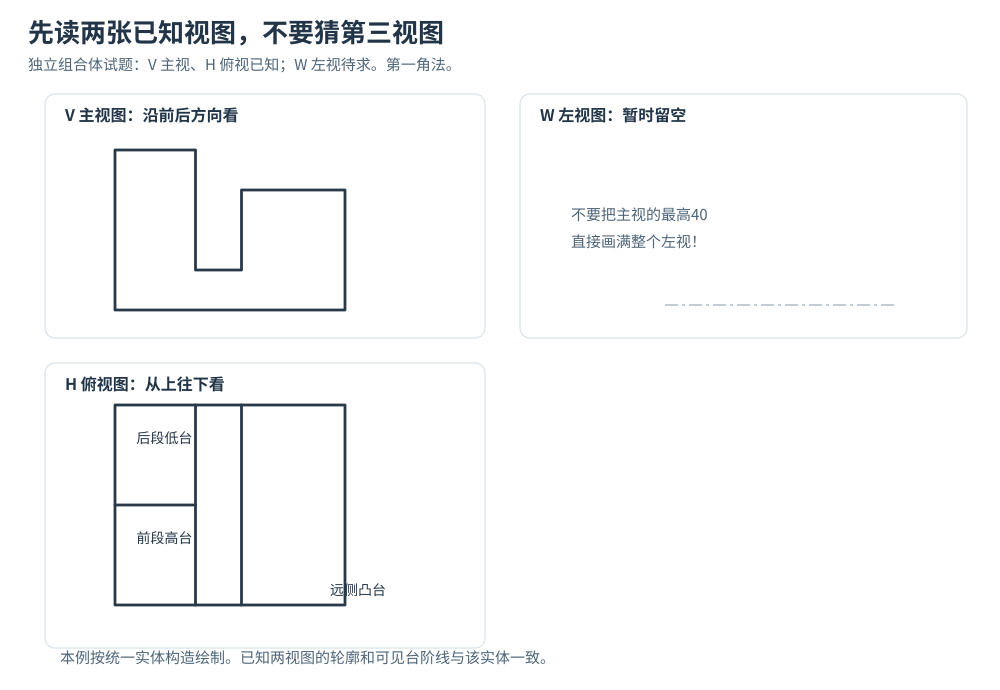
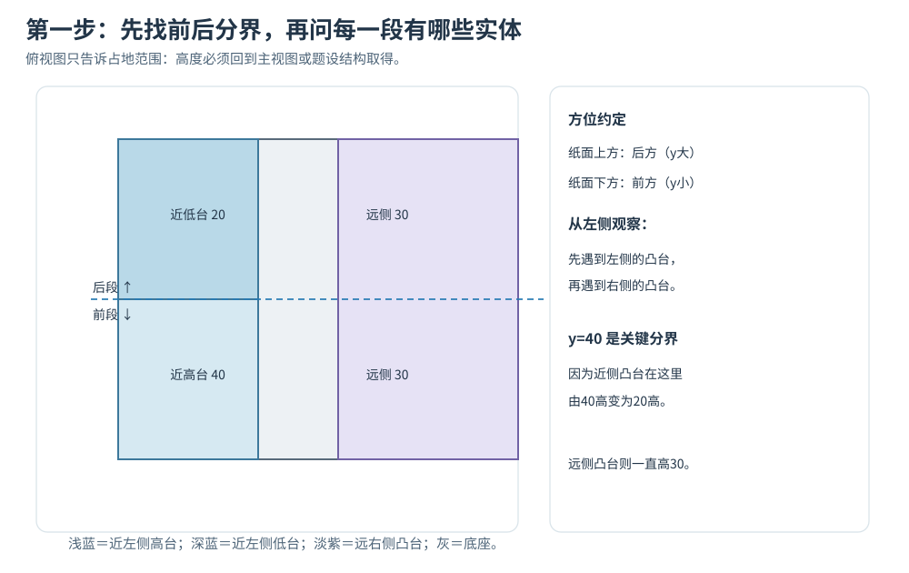
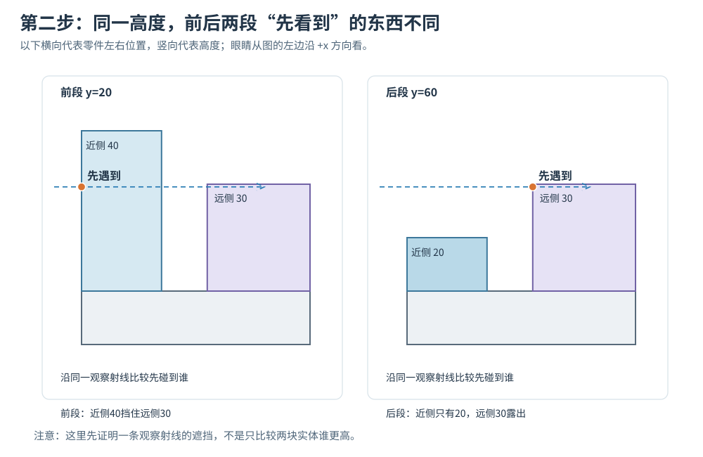
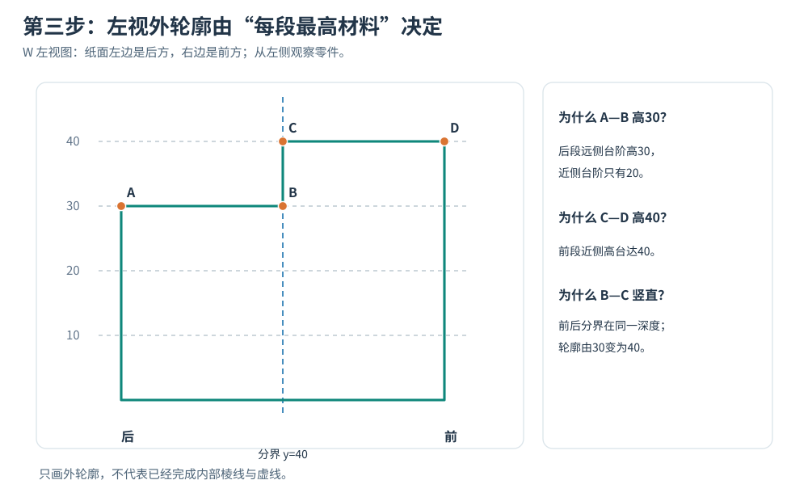
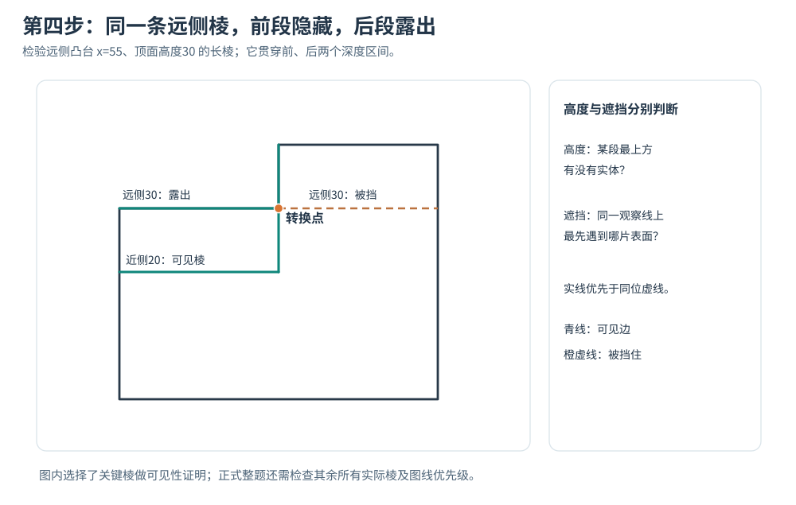
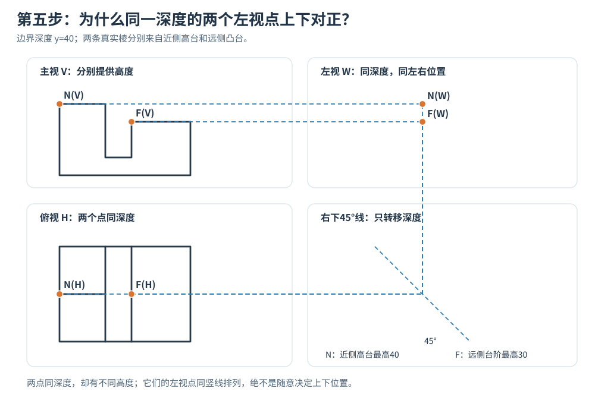
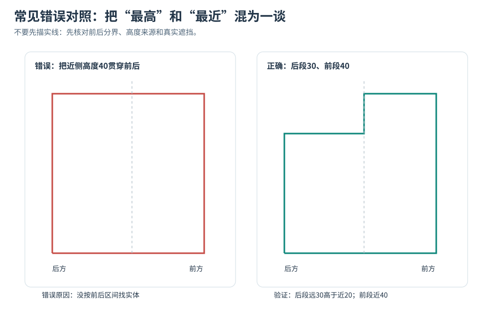

> **先回答两个不同的问题，复杂组合体就容易理解了：**
>
> **问题一：**从左侧看，图纸某个前后位置上的物体**最高到哪里**？这决定外轮廓的高度。
>
> **问题二：**如果有一条真实棱线投到这里，沿观察方向**先碰到它，还是先碰到另一片实体表面**？这决定这段棱线是否被遮住。
>
> “最高”和“最近”不是同一个条件。**不能用其中一个代替另一个。**

这是一篇可以拿纸笔跟画的教程。我们会从同一组明确的实体条件出发，完整经历**读主俯两视图 → 找关键深度 → 取得左视关键点 → 连外轮廓 → 补可见内部棱 → 检查隐藏线 → 反向验算**。

本文不使用曲线方程，不要求先在脑中想象整个三维零件。你只需要把一个复杂物体按空间区间拆开，逐步找每一个位置的依据。

**示例身份说明：**这是一道为训练方法而独立构造、尺寸和拓扑明确的组合体例题，不是假称某道教材原题的复刻。由两视图不一定能唯一推出所有隐藏结构，因此本例额外给出各块实体的真实尺寸。这一点是解题条件，而不是作弊。

---

## 一、把题目先看懂：我们到底要补什么？

我们采用**第一角法**：主视图 V 在左上、俯视图 H 在左下、左视图 W 在主视图右边。左视图表示**从物体左边向右看**的结果。

为了以后不混淆方向，先记住：

- **左右方向**：在主视图、俯视图里保留；左视图会把它压缩掉。
- **前后方向**：在俯视图、左视图里保留；主视图会把它压缩掉。
- **高低方向**：在主视图、左视图里保留；俯视图会把它压缩掉。

### 先把零件摆正，再读图纸方向

**想象零件放在桌面上，你站在零件正前方。** 面向你的一端叫“前端”，远离你的一端叫“后端”；“高、低”指离桌面的实际高度，不是纸面上的上下。

本例把零件的三个空间方向固定为：

- **左右 x：** 从物体左端 x=0 到右端 x=100。
- **前后 y：** 从朝向你的前端 y=0，向远离你的后端增加到 y=80。
- **高度 z：** 从底面 z=0 向上增加；最高到 z=40。

把零件按**第一角法**投影并展开后，才讨论图纸上的方向：

| 纸面位置 | 对应物体什么方向 | 不能误认为 |
|---|---|---|
| 俯视图纸面下方 | 前端，y 较小 | 物体高度较低 |
| 俯视图纸面上方 | 后端，y 较大 | 物体高度较高 |
| 左视图纸面右方 | 前端，y 较小 | 物体的右侧 x 较大 |
| 左视图纸面左方 | 后端，y 较大 | 物体的左侧 x 较小 |
| 主视图、左视图纸面上方 | 物体较高，z 较大 | 物体更靠后 |

**记忆方法：** 俯视图纸面“上、下”表示**后、前**；左视图纸面“左、右”表示**后、前**；物体的**实际高度**必须从主视图或左视图读取。

```text
物体前后方向（从上方看）
后端 y=80
    ↑
分界 y=40
    ↑
前端 y=0（面向观察者）

左视图横向展开（从左向右看物体）
后端 y=80 ← 分界 y=40 ← 前端 y=0
纸面左边                    纸面右边
```

这里的“前后”始终指物体的 **y 深度方向**；“近侧、远侧”始终指从左侧观察时的 **x 方向**。这两组词不能互换。



请先只看这张图中的两件事。

### 从图1读主视图：只确定左右与高度

主视图能告诉我们：左侧有高台，右侧有较低台阶，中间露出底座。**但是主视图把前后深度压缩掉了**，不能仅凭它判断高台位于前半段还是后半段。

### 从图1读俯视图：只确定左右与前后范围

俯视图显示：靠左的凸台在 y=40 有前后分界，靠右凸台从前端延伸到后端。**但俯视图不直接提供高度**，不能只看俯视图就说哪块台阶高40。

**现在对照图1再检查一次：** 在俯视图找 y=40 的分界；在主视图找高度40与30。它们来自两张不同的图，下一步才能组合到左视图。

所以，补左视图不是把主视的两条水平线搬过去，也不是把俯视外框描一遍。它必须同时符合两张图提供的不同条件。

### 本例的完整题设：四块长方体组合成一个实体

为确保每个点都能证明，这里直接给出组成信息。零件的左右总宽是 100，前后总深是 80，高度从底部向上量，单位均为 mm。

| 部分 | 左右位置 | 前后位置 | 高度范围 | 你该怎样理解 |
|---|---|---|---|---|
| 底座 | 0～100 | 0～80 | 0～10 | 所有部分共同的底 |
| **前段近侧高台** | 0～35 | 0～40（前半段） | 10～40 | 靠左、又比较高 |
| **后段近侧低台** | 0～35 | 40～80（后半段） | 10～20 | 靠左，但高度降低 |
| **远侧凸台** | 55～100 | 0～80（贯穿前后） | 10～30 | 靠右，始终高30 |

**为什么要区分“近侧”和“前段”？** 这两个词说的不是同一个方向！

“近侧”是相对于**左侧观察者**而言：靠左的实体先被视线遇到，靠右的实体较远。“前段、后段”说的是零件自身的**前后深度**。一块实体可以位于后段，但仍然靠左侧观察者很近。初学时把这两个方向混淆，后面实虚线几乎都会错。

---

## 二、第一笔为什么要从俯视图的前后分界开始？

先把左视图放一边，我们现在只看俯视图。



**请对照图2按顺序找三处位置：**

1. **纸面下半段 y=0～40：** 蓝色近侧高台，高度40。
2. **纸面上半段 y=40～80：** 蓝色近侧低台，高度20。
3. **纸面右侧贯穿 y=0～80：** 紫色远侧凸台，高度30。

图中的“上半段/下半段”只是**俯视图纸面位置**；“高40/高20/高30”才是实体的 **z 高度**。图上蓝、紫区分的是不同实体，不代表制图规范规定的图线颜色。

### 为什么先画“前后分界线”？

因为我们发现：

- 前半段的靠左凸台，到了中间位置就结束了；
- 后半段出现的是另一块更低的靠左凸台；
- 靠右凸台没有在中间断开，一直延伸到零件后端。

因此，**前后中点（深度 40）是一个真实的结构变化位置**。它不是为了画辅助线随便挑的点。

把这条深度分界转到左视图之后，我们就知道：**左视图的轮廓或内部棱，可能在这里发生变化。** 但“可能变化”不意味着所有高度的线都必须在这里断开；还要检查具体是哪片表面变化。

### 为什么不能只按主视图中“最高40”画左视？

主视图把前、后两个方向的实体压在一起。你在主视看到左部最高 40，只能说明**某处确实存在 40 高的实体**，不能说明它从前到后都是 40。

反过来，俯视图给了前后范围，却没有给高度。我们必须把**前后范围**和**高低位置**组合起来，才有资格往左视图落笔。

### 第一次自查

遮住图2，回答：为什么深度40需要作为关键点？

不是因为它恰好在正中间，而是因为**靠左的高台在这个深度结束，靠左的低台从这里开始**。如果题目中的真实分界在深度27，那么关键位置就应是27，而不是40。

---

## 三、最关键的一步：为什么“最高”不等于“最先看到”？

现在把物体当成两张相距较远的“墙”，分别从左侧观察。

- 靠左的台阶距离眼睛近。
- 靠右的凸台距离眼睛远。

但**靠左不一定更高**。这是本题的中心矛盾。



**读图3时请先固定一条视线：** 从物体左边沿 x 增大的方向看过去，先遇到 x=0～35 的近侧台阶，再可能遇到 x=55～100 的远侧凸台。接下来只改变前后深度 y，不改变观察方向。

| 取样深度 | 近侧实体最高 | 远侧实体最高 | 左视外轮廓最高 |
|---|---:|---:|---:|
| 前段，例如 y=20 | 40 | 30 | 40 |
| 后段，例如 y=60 | 20 | 30 | 30 |

**注意：** 表中“最高”是同一深度范围内实体占据的最大 z；某条棱是否被挡住，还要在它自己的高度沿 x 方向检查遮挡。

图3是两个真实的局部剖面。它不是想象性的立体效果，而是把前段、后段分别沿一个固定前后位置切开，然后从左向右看。

### 先看前半段：近侧40，远侧30

假设你在物体前半段的一个位置看过去。

左边那块近侧高台一直高到 40。右边远处的台阶只有 30。

**问题：从左侧看，高度30附近，眼睛先看到谁？**

先碰到靠左、又高到40的实体。远处的30高台阶在它后面，所以远处那条高度30的棱线被挡住。

**但这里还要分清另一件事：这个前段外轮廓最高到哪里？**

最高到40。因为近侧实体确实达到40，远侧没有更高的部分露出来。

因此前段有两个不同结论：

- **外轮廓最高 = 40。**
- **远侧高度30的棱线 = 存在，但被遮挡。**

你现在应该能理解：外轮廓的最高位置和某条内部棱的可见性，分别由不同问题决定。

### 再看后半段：近侧20，远侧30

移到物体后半段，还是从左侧看。

这次靠左的实体只高20，而右边远处的台阶高30。

**问题：远侧高度30的位置，会被近侧高度20的台阶挡住吗？**

不会。因为在高于20的那部分空间，靠左的台阶已经没有材料。视线可以继续向右，到达远处高30的实体。

于是后段得到：

- **外轮廓最高 = 30。**虽然最高的表面来自远侧凸台。
- **远侧高度30的上边缘 = 露出，可以在左视图中看到。**
- **近侧高度20的顶部棱 = 也可能成为可见的内部边，需检查它的真实棱线和遮挡。** 本例确实存在这条可见边。

### 把原理说成一句话

**找外轮廓的高度：**问“在这个前后位置，所有实体里最高有什么材料？”

**找一条棱可不可见：**问“沿同一条从左向右的视线，哪片实体表面先挡住它？”

千万不要说“近处的一定形成最高外轮廓”，也不要说“远处的一定是虚线”。这两句话都可能错。

---

## 四、开始补左视图：四个关键点 A、B、C、D 为什么在这里？

现在已经知道：后半段最高30，前半段最高40；真正发生变化的是前后深度40的位置。

因此，我们可以**不猜空间整体形状**，直接从已知条件落到左视图上。



**先看图4中的 A→B→C→D，再读下面四笔：**

**四个点的位置必须同时满足深度和高度：**

| 点 | 深度 y | 高度 z | 理由 |
|---|---:|---:|---|
| A | 80（后端） | 30 | 后段远侧凸台最高30 |
| B | 40（分界） | 30 | 后段轮廓延续至分界 |
| C | 40（分界） | 40 | 前段近侧高台达到40 |
| D | 0（前端） | 40 | 前段轮廓保持40 |

按左视图纸面从左向右：**A→B 为高度30的水平线，B→C 向上升到高度40，C→D 为高度40的水平线。** 以上数值是本例题设尺寸，不是通用的标准尺寸。

### 第1笔：先画左视图区的高度基准

从主视图取到底座高度、30高台阶和40高台阶的高度，用细水平辅助线引入左视图区。为什么要引线？因为主视和左视**同一个空间高度必须保持平齐**。

如果不知道某条内部台阶高度，比如本例后段近侧的20，那么它必须来自题设尺寸、另一种有效视图或已经证明的结构关系，**不能仅凭两张外轮廓自行假设20。**

### 第2笔：把俯视图的前后分界转移到左视区

通过第一角法的45°转移线，把前后深度40的位置移到左视图。它决定图中 B、C 所在的那条竖向位置线。

为什么 B、C 左右位置相同？因为两者都在**同一个前后分界**。它们高度不同，但深度相同。

### 第3笔：先找 A——为什么后方最左端高度30？

A 对应零件最后端的深度。在这个深度里，靠左近侧台阶只有20，但靠右远侧凸台高30。

所以这个位置的**最高外轮廓**是30。A 必须在后端深度线和30高度线的交点。

为什么不是20？因为远处确实有更高的实体，20并不会把30以上的部分挡住。

### 第4笔：找 B——为什么沿后段一直保持高度30？

从最后端向前走，直到中间分界之前，靠左的台阶都只有20，远侧台阶一直是30。

也就是说，**这个深度区间的最高轮廓始终没有变化**。因此 A—B 是高度30的一条水平轮廓线。

为什么不在中间某处拐弯？因为该区间内没有任何更高的实体出现，也没有实体范围发生变化。

### 第5笔：找 C——为什么在分界线突然升高到40？

越过前后中间分界以后，近侧出现高度40的高台。它比远侧30更高。

所以在同一条深度分界线上，外轮廓从30升到40，形成 B—C 的竖向外轮廓转折。

注意：**B—C 这一小段之所以是外轮廓，是因为高于30到40之间，前后两侧的最高材料发生了突变**。它不是随手在中点画一条竖线。

### 第6笔：找 D——为什么前半段最高轮廓一直40？

从中间分界到物体最前端，靠左高台始终高40，且没有其他更高的实体。

所以 C—D 是高度40的水平轮廓线。最后沿零件前端向下连接底部，再沿底部返回后端，完成外边框。

**到此只证明了外轮廓。内部棱线尚未完成，更谈不上已经画好全部实虚线。**

---

## 五、为什么还要补高度20的实线和高度30的虚线？

现在已经有外轮廓，但工程图不是只画一个封闭的大框。零件上真实存在的内部棱边，也需要判断是否在左视图中出现。



**看图5时请只追踪同一条 z=30 的远侧顶部棱：**

- **纸面右半段（物体前段 y=0～40）：** 近侧高台到 z=40，遮住远侧 z=30 棱；若题目要求表达隐藏棱线，画细虚线。
- **纸面左半段（物体后段 y=40～80）：** 近侧低台只到 z=20，远侧 z=30 棱露出；它也构成此段外轮廓，画粗实线。

不要把“纸面左半段”误读为“物体左侧”。前者是左视图展开后的前后深度位置，后者是 x 方向。

### 先找高度20的近侧顶部边：为什么画成实线？

看后半段。近侧低台的顶部高度20，向前后方向延伸整个后半段。

它和近侧竖直侧面相交形成一条真实棱线。又因为它就在靠近左侧观察者的表面边界上，前方没有其他实体把它挡住，所以这段棱线**可以看见**。

于是，在后段范围内，左视图高度20的位置会有一条可见的内部水平线。

它为什么不能延伸到前半段？因为前半段不是那块20高的低台，而是40高的高台。继续延伸就失去了真实的空间棱线来源。

### 再找远侧顶部边：为什么同一条棱一半实、一半虚？

我们研究的是同一条空间棱：**远侧凸台靠左那条顶部棱，高度30，从前端一直延伸到后端**。

不要急着问它是不是在图纸中间。我们把它分成两段：

**前半段：**它位于靠右的远侧凸台，左边还有高达40的近侧高台。高度30的视线先碰到近侧实体，所以远侧的这段真实棱**被遮挡**。如果需要按题目画出隐藏棱线，应在相应位置用细虚线表示。

**后半段：**左边近侧低台仅高20；高度30的视线可以越过它上方的空隙，看到远侧凸台顶部边。因此这段同一条空间棱**露出来**，并成为左视外轮廓的一部分。

**这就是“同一条空间棱，左视投影却需要按前后区间改变可见性”的原因。**

### 最关键的分界在哪里？

在深度40处。因为近侧实体恰好从高40改变为高20，遮挡关系在这里发生变化。

因此这里不仅是**轮廓高度的转折位置**，也是**远侧棱线可见性的切换位置**。

但这只是本题的巧合：在更复杂的零件中，外轮廓转折点与隐藏线转换点完全可能不在同一个地方。**必须分别检查。**

### 为什么中间还会有一段竖向的可见内部棱？

高台与低台在前后分界处连接：靠左的实体从40高降到20高。因此沿这个分界位置，高20到40之间有一条真实的台阶边。

这条竖线的上半段（30到40）已经属于外轮廓转折 B—C；下半段（20到30）虽然落在外轮廓内部，却仍是靠左侧能够看到的真实棱，所以也要按可见边检查，而不能直接省略。

这一步可以纠正另一个常见错误：**不是“外边界才画实线，内部的线都画虚线”。**

### 图线重合怎么办？

真实空间棱投到纸上，有时会与另一条可见边、隐藏线或中心线完全重合。此时不是把几种线重叠描一遍，而应遵守图线优先原则。通常**可见实线优先于隐藏虚线，隐藏虚线优先于中心线**。但仍要遵守题目采用的制图标准和局部表达约定。

另外，并非所有隐藏线都值得画得很密。正式作图还应结合题目要求与读图清晰度，保留必要信息，避免杂乱。

---

## 六、如果要在真实作业纸上画，45°转移线究竟怎么用？

前面解释了为什么点的位置应该如此。接下来必须回答**纸上实际怎样落点**。

这里选择两个真实的空间点作为演示：

- N：靠左高台的上端，处于前后分界，高度40；
- F：远侧凸台的顶部边，在相同前后分界上，高度30。

这两个点的左右位置不同、高度不同，但**前后深度相同**。



**图6请分四次看，不要一次盯着所有辅助线：** ① 在主视图找40、30两条高度线；② 在俯视图找 y=40 深度分界；③ 沿45°转移线把深度传到左视区；④ 用同一深度竖线与两条高度水平线相交，得到上下两个不同点。

**第一笔：**在主视图识别 N 所属的靠左高台上端和 F 所属的远侧凸台顶部。分别从主视投影向右引对应**高度水平线**。

**第二笔：**在俯视图找到二者对应的前后分界。注意 N 与 F 的左右位置虽然不同，但它们都落在**同一条深度分界**。

**第三笔：**在俯视图把深度距离向右引到右下角45°转移线，再向上引到左视图。

**第四笔：**用转移来的同一深度位置分别与刚才两条高度线相交。于是左视中得到 N 在40高、F 在30高，且两点位于**同一条竖线上**。

为什么 N 一定在 F 上面？因为它们同深度，而 N 的实际高度40高于 F 的30。这里“上下”不是凭感觉，也不是通过俯视图的上下决定，而是**主视和题设的真实高度**决定。

### 还要检查什么？

**45°线只负责搬运前后深度。** 它既不会告诉你零件有多高，也不会自动证明两个点是同一条空间棱的端点。

如果你把俯视前侧误当后侧，左视图就会左右翻转；如果把主视的高度线对错，左视点就会上下移错。转移前必须先确定同名点属于哪一块实体。

---

## 七、五种最常见错误，一次彻底排除



| 错误做法 | 为什么错 | 正确检查方法 |
|---|---|---|
| 把主视最高40画满整个左视 | 主视看不出40高台的前后范围 | 先从俯视找该高台起止深度 |
| 认为靠左实体最近，所以一定形成最高轮廓 | 后段近侧仅20，远侧却有30 | 同一深度比较所有实体的最大高度 |
| 认为远处所有棱都画虚线 | 后段远侧30高的顶部实际露出 | 沿观察视线比较哪个实体先被碰到 |
| 只画外轮廓，漏掉内部实线 | 后段近侧20高顶部是真实可见边 | 逐块寻找真实棱，再判断可见性 |
| 俯视某两线交叉就直接在左视连接 | 投影交叉不证明空间相交 | 查两线是否属于同一空间棱或共同边界 |

还有一条贯穿全文的原则：**不能因为图纸外形已经画对，就宣布完整第三视图已经解出。** 你还要检查每一条真实棱、每个端点、隐藏线和图线重合优先关系。

---

## 八、面对带槽、通孔、台阶的更复杂组合体，方法还能用吗？

可以，但不能只记“前后分成两段”这一招。

本例只在一个前后分界发生结构变化。真正的组合体可能有好几个凹槽、通孔和多个凸台，这时应当：

**1. 根据实际结构变化分区，而不是平均分区。** 孔口开始、孔壁结束、凸台边界、槽底出现的位置，都可能需要另划分界。

**2. 分清加料与去料。** 凸台是实体增加；凹槽、通孔是材料被挖去。看到俯视图一圈线，不能自动判断是凸圆柱还是圆孔，必须结合其他视图、尺寸或题设。

**3. 每个区间都先检查“哪里有材料”。** 外轮廓的高度来自真实实体占据的最高位置，而不是只来自最近实体。

**4. 再检查每一条真实棱是否可见。** 对某个待画线段，在同一观察视线上比较前后，找到遮挡开始和结束的位置。圆柱、圆锥的视向轮廓线与真正的棱还要分开处理。

**5. 不能凭空补一个隐藏结构。** 如果两个已知视图同时符合“有孔”和“没有孔”的不同三维结构，而题目没有其他条件，那就是信息不足。正确做法是标出歧义，不是随意猜一个标准答案。

---

## 九、三道练习：合上本文，你能独立判断吗？

做练习时先画一个小小的前后分区表，不要立即画整张图。

### 练习一：只把后段近侧低台从20加高到35

其他条件不变：远侧凸台仍高30，前段近侧高台仍高40。

请回答：后段最高轮廓是多少？远侧凸台顶部那条30高的棱，在后半段还能从左侧看到吗？前后分界处轮廓高度相差多少？

**答案与理由：**后段最高变成35，因为近侧后段台阶已经高于远侧30。后段远侧30高棱被近侧35高实体遮挡；前后轮廓分别为40、35，相差5。不是把原图一条线往上挪就行，还需要重新判遮挡。

### 练习二：只把远侧凸台从30加高到45

其他条件不变：前段近侧40、后段近侧20。

请回答：前段、后段的最高轮廓分别多高？中间还有外轮廓从30变40的台阶吗？近侧前段40高的顶部棱一定被隐藏吗？

**答案与理由：**两个区间的最高轮廓都变45，因为远侧凸台在前后全段高45。原来的30→40外轮廓转折消失了。但近侧前段40高的顶部棱并不因此自动隐藏：它位于靠左侧的实体表面上，仍需要按实际观察射线检查，不能由“外轮廓变45”推断所有内部线都不可见。

### 练习三：两种不同实体，外轮廓可以一样吗？

保持前段近侧40、远侧30，但把后段近侧20高台整块去掉，后段只剩底座和远侧30高台。

请问：左视外轮廓与原例相比会变吗？原来后段高度20的内部棱还存在吗？

**答案与理由：**左视外轮廓仍是后段30、前段40，因此**外框不一定改变**。但后段原来存在的20高近侧顶部棱已经被删除，不能继续画。说明两个零件即使外轮廓相同，内部棱线仍可能不同。**只看外框判断第三视图是否完整是不够的。**

---

## 十、复杂补第三视图的真正解题框架

做到陌生题时，建议用下面这套顺序，不要先背一幅标准答案的形状。

1. **认清方向。** 主、俯、左各保留哪些位置？观察者从哪一侧看？
2. **认清实体。** 哪些是真实凸台、哪些是孔和槽？哪些尺寸已经给出，哪些只是猜测？
3. **划真实分界。** 在前后深度变化、孔槽起止和台阶交接处找关键点。
4. **按区间找外轮廓。** 同一深度最高的真实材料在哪里？把高度和深度对应起来。
5. **逐条检查内部棱。** 哪条真实存在、起止在哪里、属于哪块实体？
6. **逐段判可见性。** 沿观察方向，哪片表面在前？遮挡是否中途变化？
7. **按规范整理图线。** 实线、虚线、轴线、辅助线不能混用；投影重合须遵守优先关系。
8. **反向验算。** 把左视结果对应回主、俯视，检查有没有多画、漏画、连错或题设不足。

### 什么程度才算真正学会？

不是能模仿画出同一个台阶轮廓，而是能在不看答案时解释：

**“后段为什么最高30？”**——因为远侧30高于近侧20。

**“为什么远侧30的棱前段是虚的？”**——因为左侧40高实体挡住了同一观察视线。

**“为什么中间这条竖线不能一直延伸到底？”**——因为不同高度的部分来自不同空间边界，必须按真实棱线端点和可见性分别处理。

**“为什么知道左视外轮廓仍不能说整题完成？”**——因为真实内部棱与隐藏线尚需单独求证。

只要这些问题能独立回答，你就已经从“看图猜第三视图”迈向“用空间关系一步一步推导第三视图”。

---

**参考与作图约定：**采用第一角法的视图布局与常规可见线优先于隐藏线的表达原则。可参阅 [ISO 128-3:2022 第一角法视图布置](https://standards.iteh.ai/catalog/standards/iso/75d888a5-6e9a-4fac-9120-8f2dffc20899/iso-128-3-2022) 和 [Engineering Graphics & AutoCAD 的图线优先级说明](https://static.sdcpublications.com/pdfsample/978-1-58503-747-6-4.pdf)。本文所有实例尺寸及图形均为自构造模型，图中的辅助色不代表标准图线颜色。