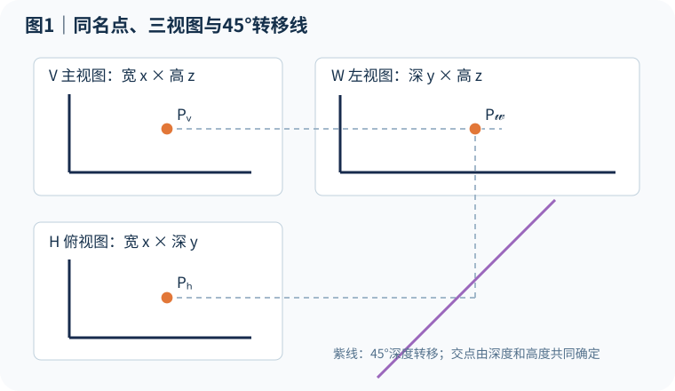
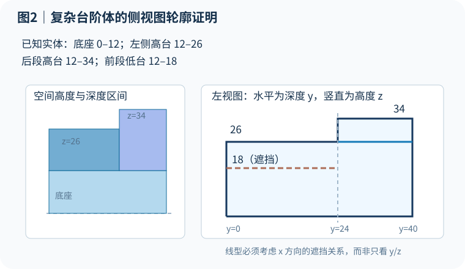
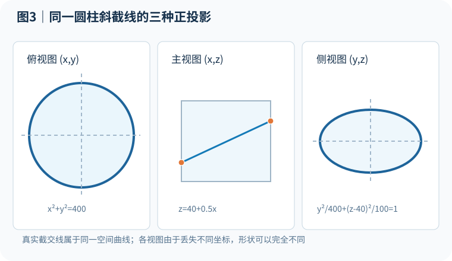
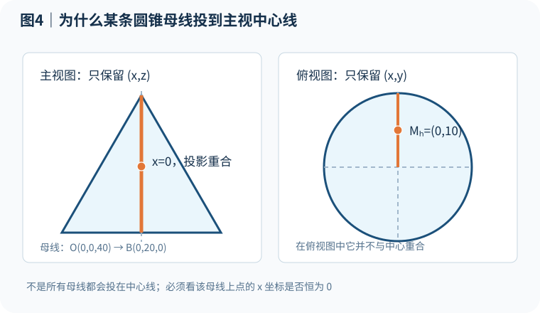
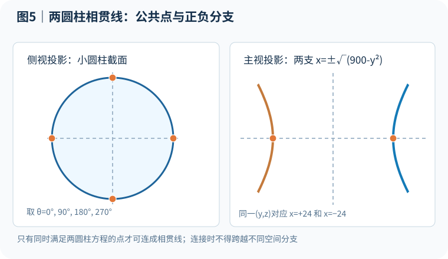

> **先建立空间关系，再确定投影；先证明线为什么存在，再决定它怎么画。**
>
> 工程制图不是先猜一张“像答案的图”。这篇教程要做的是把每一条线的来源追溯到点、棱、面、交线和遮挡关系，最后能独立说明：这个点为什么在这里？这两个点为什么相连？曲线为什么会变成椭圆？实线和虚线到底由什么决定？

**适用对象：**刚接触机械制图或工程制图的初学者；已会简单三视图，但碰到凹槽、复杂组合体、截交线和相贯线就难以下笔的人。全文用**第一角法**，并约定空间坐标为：宽度 $x$、深度 $y$、高度 $z$。所有数值单位可以视为 mm。

**学习路线：**点的位置 → 线、面与拓扑 → 三视图对应 → 复杂补第三视图 → 截交线 → 相贯线 → 遮挡与标准线型 → 自测与 DraftAI 自动解题逻辑。

> 提醒：文中数字算例和配图均为教学构造，不是教材原题的标准答案。数值可以用于验证方法；不能把某个自构造示意强行套到你的习题册上。

## 一、先改变解题顺序：图是结果，不是起点

遇到补第三视图，有人会从已知主视图找一个“看起来比较像”的轮廓，再试图在俯视图中找到与它匹配的线。遇到斜切圆柱，直接背“是椭圆”；遇到相贯线，直接把几组点用光滑曲线连起来。这些做法一遇到复杂组合体，就会出现缺线、线段长短错误、前后颠倒和虚实线误判。

更稳定的解法是先回答五个问题：

1. **题目究竟已知什么？**包括视向、投影方法、轮廓、尺寸、轴线、对称条件、通孔和实体结构。
2. **空间中有哪些真实对象？**例如点、直线棱、平面、圆柱面、圆锥面、截平面。
3. **对象如何连接？**两个点属于同一棱吗？两个面是否相交？二维投影重合的线，三维位置是否相同？
4. **这些对象投影到纸上在哪里？**投影只确定位置和形状，不自动决定线型。
5. **从观察方向看能否看到？**同一投影位置上，哪一片实体表面离观察者最近？

可以记作 **条件 → 空间结构 → 连接关系 → 投影位置 → 可见性 → 作图步骤**。

这里的“线”有不同身份：实体的棱、截平面与曲面的交线、两个曲面的相贯线、曲面的视向轮廓线、中心线、投影辅助线。它们不能混为一谈。尤其是圆柱侧视轮廓母线：它在某一观察方向形成轮廓，并不意味着实体上有一道真实的棱。

## 二、零基础：一个点为什么会有三个投影？

先把空间位置写成

$$
P=(x,y,z)
$$

$x$ 指左右宽度，$y$ 指前后深度，$z$ 指上下高度。三视图分别把其中一个坐标“压扁”掉：

| 视图 | 保留的两项 | 无法从这一视图直接看到 |
|---|---|---|
| 主视图 V | $(x,z)$：宽和高 | 深度 $y$ |
| 俯视图 H | $(x,y)$：宽和深 | 高度 $z$ |
| 左视图 W | $(y,z)$：深和高 | 宽度 $x$ |

**例子：**点 $P=(32,14,26)$。它的主视位置是 $(32,26)$，俯视位置是 $(32,14)$，左视几何坐标是 $(14,26)$。注意：左视图中“前后方向在纸面上的左右顺序”，还要由实际视向和第一角法的展开方式确认，不能单独靠坐标正负号猜。

### 1. 为什么45°转移线可以找第三视图？

第一角法中，主视图在上、俯视图在下，左视图放在主视图右边。主、左视图对应**同一个高度**，俯、左视图对应**同一个深度**。

要从主视和俯视确定某个左视点：

**第1步：**在主视图找到该点，从它向左视图方向作水平辅助线。这条线提供高度 $z$。

**第2步：**在俯视图找到**同一个空间点**的投影，把该点到主俯视图基准的深度距离，通过右下方的45°转移线搬运到侧视图区域。

**第3步：**沿转移得到的深度位置向上引线，与第1步的高度线相交。交点就是目标左视点。

**为什么必须这样画？**新点既要满足主视图给的高度，又要满足俯视图给的深度。交点是两个条件共同确定的位置，45°线只是传递等距信息，而不是创造一个新条件。

**特别注意：**45°辅助线方向和起点取决于视图布局。它不是“永远朝右上”或“永远朝右下”的死规则。题目换了视图位置、换为右视图或改用第三角法，辅助线也要跟着改变。

### 2. 同一投影点，为什么不一定是同一个空间点？

令 $A=(10,5,20)$、$B=(10,35,20)$。二者主视投影都是 $(10,20)$，因为主视图舍掉了 $y$。但它们在俯视图的深度位置显然不同。

因此：**二维重合不代表三维同一。**两条线在一个视图重合，也可能来自相隔很远的两条不同空间棱。需要至少另一个投影或结构条件来判断。

### 3. 两个点位置都找到了，就应该连接吗？

不一定。知道点的位置，是**几何位置证据**；知道两点之间存在棱或曲线的一段，是**拓扑连接证据**。只有属于同一真实棱、两个相邻面共享边，或者属于同一截交/相贯曲线分支的相邻点，才有依据连接。否则画出的直线只是想象中的连线。

## 三、复杂补第三视图：先还原空间，再画轮廓和被遮挡边

这一类题最难的是：两个已知视图把三维深度或宽度压扁了。同一二维位置上，可能叠着几个不同高度、不同深度的实体。正确做法不是“抄已知线”，而是问：**从新观察方向看，每个位置最前面看到的究竟是哪块表面？**

### 案例：带底座、两层台阶和前后不同高度的组合体

为避免凭空猜结构，先给出一组明确的空间实体（这是演示题，不是假称从两视图唯一还原的教材题）：

| 实体组成 | 宽度 x | 深度 y | 高度 z |
|---|---|---|---|
| 底座 | 0～60 | 0～40 | 0～12 |
| 靠左的较高台阶 | 0～25 | 0～40 | 12～26 |
| 后侧高台阶 | 25～60 | 24～40 | 12～34 |
| 前侧低台阶 | 25～60 | 0～24 | 12～18 |

现在求**左视图**。左视方向沿 $x$ 轴观察，所以左视图纸面上研究的是 $(y,z)$。但不要误解为 $x$ 不重要：$x$ 虽然不占纸面坐标，却决定谁挡住谁。

### 步骤1：分清“前段”和“后段”

观察题目给出的所有台阶。由于高台阶在 $y=24$ 处开始，**$y=24$ 就是深度方向的结构分界**。因此先研究 $0\le y<24$，再研究 $24<y\le40$。不要无缘无故把俯视图分成十段，应该在结构变化处划分区间。

### 步骤2：求前段的侧视最高轮廓

在 $0\le y<24$ 内，底座到高度12，靠左台阶到26，前侧低台阶到18。因此在这段深度上，实体最高达到 $z=26$。

所以左视图的这段上轮廓画在 **$z=26$**。它不是因为“看起来左边应该高”，而是空间中存在一片实体表面达到26，并且该处没有更高的实体投影覆盖其上轮廓。

### 步骤3：求后段的最高轮廓

在 $24<y\le40$ 内，后侧高台阶高度34，左侧台阶高度26。整体最高高度变成 $z=34$。

所以后段上轮廓是 **$z=34$**。在 $y=24$ 处，侧视上边界从26跃升到34；必须在对应深度位置形成一段从 $(24,26)$ 到 $(24,34)$ 的竖向转折线。

**为什么竖线恰好在这里？**因为 $y=24$ 是空间中的真实台阶分界；它的侧视位置由深度坐标唯一确定，竖线两个端点高度由左右两段最高值给出。

### 步骤4：外轮廓画完，还要找真实内部棱

只描一个封闭外框并不等于解完题。后段同时存在高为26的左侧台阶和高为34的后侧台阶。不同表面相接、前后深度关系变化时，还可能出现可见的内部分界线，例如图示后段的 $z=26$ 位置。

需要回到三维结构检查这条线是两个表面的交界、不同深度表面的投影边界，还是只有辅助意义的分割线。

### 步骤5：低台阶为什么可能要画虚线？

前段还存在高度18的低台阶，但它位于较远的 $x$ 位置；更靠近左侧观察者的台阶高度达到26，会遮住它的顶部棱线。所以该边虽然存在，却不直接可见，应按隐藏棱线考虑。

**注意三件事：**

- 虚线不是因为“在图形里面”，而是有更近的实体遮挡。
- 它只在真实棱线存在的深度范围内画出，本例是 $y=0$ 到24，不能随意延伸到40。
- 如果题目允许省略某些被完全覆盖、与其他线型重合的隐藏线，仍应服从本课程或图样采用的制图标准和线型优先级。

### 步骤6：逐条核对端点

每条线都要回答三项：**从哪里起？到哪里止？为什么在该处停止？** 例如高台阶只占后段，不能把 $z=34$ 的水平线延伸到前段；$y=24$ 的转折边也不能随手向底部贯通。

### 复杂补第三视图的“六问法”

1. 这段轮廓从哪个真实面或棱来？
2. 它的高度由主视图哪一处决定？
3. 它的深度由俯视图哪一处决定？
4. 它的端点为什么恰好落在这里？
5. 如果一处有两条空间棱投影重合，哪条更靠近观察者？
6. 已知条件真的能唯一确定三维结构吗？

**重要的认识：两个视图不总能唯一确定复杂实体。**例如不同深度的孔、内部凹槽和局部遮挡都可能在两个投影下产生相似轮廓。如果多个三维结构都满足已知条件，就应结合尺寸、对称符号、剖切标记和题目默认的实体特征，不能编造唯一第三视图。

## 四、截交线：寻找“平面与曲面都经过的点”

**截交线 = 截平面与物体表面的公共点集合。**

圆柱被斜平面切开以后，不要先抓笔画椭圆。应先问：每一个截交点在哪条母线上？它在截平面上的高度是多少？其余视图投影在哪里？找到足够多的关键点以后，才能可靠地形成曲线。

### 例题：圆柱斜截，为什么俯视是圆、主视是直线、侧视是椭圆？

设竖直圆柱半径20，其侧面满足

$$
x^2+y^2=400
$$

斜截平面为

$$
z=40+0.5x
$$

假设圆柱本身足够高，截平面沿整个圆周都能与柱面相交。取圆周位置

$$
x=20\cos\theta,\qquad y=20\sin\theta
$$

将 $x$ 代入平面方程：

$$
P(\theta)=(20\cos\theta,\ 20\sin\theta,\ 40+10\cos\theta)
$$

不用一上来背三角函数：它表达的只是**选定圆周上的一个位置，就能算出对应的斜截高度**。

先找四个特殊点：

| 点 | x | y | z | 为什么重要 |
|---|---:|---:|---:|---|
| 最高点 | 20 | 0 | 50 | 截面高度最大 |
| 深度一端 | 0 | 20 | 40 | 决定深度极值 |
| 最低点 | −20 | 0 | 30 | 截面高度最小 |
| 深度另一端 | 0 | −20 | 40 | 另一侧深度极值 |

**俯视图 H：**丢掉 $z$，保留 $(x,y)$。全部公共点仍满足 $x^2+y^2=400$，所以看上去是一整圈**圆**。但这不代表斜截线在空间里的真实形状就是圆。

**主视图 V：**丢掉 $y$，保留 $(x,z)$。由于每个点都满足 $z=40+0.5x$，所以主视图是一段**斜直线**。注意两个深度不同的点可能在这里重合。

**侧视图 W：**保留 $(y,z)$，消掉 $x$。由 $x=2(z-40)$ 联立圆柱方程，可得

$$
\frac{y^2}{400}+\frac{(z-40)^2}{100}=1
$$

这就是侧视图中的**椭圆**。

**核心结论：同一条空间椭圆曲线，正投影到三个方向，可以分别成为圆、直线段和椭圆。**因为各视图保留的是不同的两个坐标。空间真实形状与某个视图的投影形状不能混淆。

### 初学者手工作图：六步固定法

**第1步：辨识原曲面。**确定是圆柱、圆锥、球还是棱柱；确认轴线、轮廓母线和投影特点。

**第2步：辨识截平面。**看它与轴线、母线以及各投影面的关系。截平面经过顶点吗？是平行某个方向还是斜切？

**第3步：优先找特殊点。**最高、最低、最左、最右、轮廓母线上的交点和可见性即将变化的点。这些点决定曲线的整体范围。

**第4步：求一般点。**圆柱常沿母线找截点；圆锥常选水平辅助平面，先得到辅助圆，再找辅助圆与截平面的交点。

**第5步：三个视图严格对应。**点 A 在一个视图出现后，必须用同名投影关系确定 A 在其他视图的位置。不能把 A 的主视和 B 的俯视错误对应。

**第6步：按空间邻接顺序连接、再裁剪和判虚实。**截交线位于有限实体表面，不能无限延长；光顺曲线不能直接连接不相邻的点。

### 圆锥斜截为什么会有椭圆、抛物线、双曲线？

判断理想完整双圆锥与平面的非退化交线时，关键是截平面和**圆锥母线方向**的关系：

| 截平面情况 | 曲线类型 | 几何解释 |
|---|---|---|
| 与轴线垂直 | 圆 | 截取固定半径的圆周 |
| 斜切一叶，且不平行母线 | 椭圆 | 闭合交线 |
| 平行某条母线方向 | 抛物线 | 闭合与开放的临界情况 |
| 与双圆锥两叶相交 | 双曲线 | 分成两支开放曲线 |

具体有限圆锥会受到底面、端面或其他边界裁剪，最终图上可能只剩下曲线一部分；经过顶点还可能退化成直线等情形。不要看到某条“弯曲的线”就想当然叫椭圆。

### 为什么某条圆锥母线投影恰好落在中心线？

假设圆锥顶点 $O=(0,0,40)$，一条底圆母线端点是 $B=(0,20,0)$。这条母线上**任何点都有 $x=0$**。主视图只保留 $(x,z)$，所以整条母线的主视投影就在 $x=0$ 的中心线上。

但它在俯视图是从圆心向圆周延伸的径向线。**不是所有母线都投在主视中心线**，只有那些在该视向下横坐标始终为0的特殊母线才如此。

再举一个易错问题：“同一高度的截交点为什么有的画右边，有的画左边？”因为**高度只确定一项坐标**，左右位置还必须由它所在的母线、辅助圆及其他投影确定。不能凭对称感任意选择方向。

## 五、相贯线：让一个点同时满足两个曲面的条件

相贯线是**两片曲面相交的空间曲线**。与截交线很像：

- 截交线：曲面 $\cap$ 平面。
- 相贯线：曲面 A $\cap$ 曲面 B。

前者一个约束是平面，后者两个约束都是曲面；寻找公共点、连接分支、投影和判断可见性的逻辑是相通的。

### 例题：竖直大圆柱与水平小圆柱正交

竖直大圆柱的轴沿 $z$，半径30：

$$
x^2+y^2=900
$$

水平小圆柱的轴沿 $x$，半径18，轴线高度 $z=25$：

$$
y^2+(z-25)^2=324
$$

相贯线上的点必须**同时满足**两个方程。先沿小圆柱的圆周选角度：

$$
y=18\cos\theta,\qquad z=25+18\sin\theta
$$

把 $y$ 代入大圆柱方程得到

$$
x=\pm\sqrt{900-y^2}
$$

看见这个 **$\pm$** 一定要留意：同一个 $(y,z)$，往往有两个不同空间交点，分别位于 $x>0$ 和 $x<0$ 两侧。这是两个需要分别跟踪的空间分支，不能因为纸面投影靠得近就把它们乱连。

| 小圆柱取点 | y | z | 对应大圆柱 x |
|---|---:|---:|---|
| $\theta=0^\circ$ | 18 | 25 | $\pm24$ |
| $\theta=90^\circ$ | 0 | 43 | $\pm30$ |
| $\theta=180^\circ$ | −18 | 25 | $\pm24$ |
| $\theta=270^\circ$ | 0 | 7 | $\pm30$ |

**画法中的四个关键问题：**

**① 为什么点在这里？**因为它同时满足大圆柱和小圆柱的曲面方程。只满足其中一个的点不属于相贯线。

**② 为什么不能直接连最近的两个点？**空间曲线的顺序取决于圆柱母线、辅助面的连续变化以及分支关系，不取决于纸面距离。应该固定 $x$ 正分支或负分支，沿同一参数方向连接。

**③ 为什么不能仅凭画得光滑就说正确？**还要经过极值点、轮廓母线交点，验证空间曲线的连接与切线连续性，遇到特殊切触或交线分叉更需要单独处理。

**④ 为什么某视图只有一条线却可能有两支空间曲线？**因为一个坐标被正投影舍弃，前后不同深度的点可能重合。投影重合不等于空间相同。

这个例题说的是**数学意义上无限圆柱侧面的交线**。在真实机械零件中，还必须考虑有限长度、端面、通孔或实体组合方式。只有属于实际表面并在真实范围内的交线部分，才应该进入最终工程图。

### 不想背公式，怎样手工找相贯点？

用**辅助面法**。选一些容易同时与两个曲面相交的辅助平面，分别作出两个曲面的辅助截线，再找这些截线的公共点。选辅助平面的原则是：尽量让辅助截线成为易作的圆或直线。也可以沿圆柱母线选点，逐条找到与另一圆柱曲面的交会。

步骤仍然是：**取辅助面 → 画两条辅助截线 → 求交点 → 转移到各视图 → 保持空间分支顺序连线 → 裁剪 → 判线型。** 相贯线因此不是“一笔凭感觉画出来”的神秘曲线，而是大量简单公共点问题的集合。

## 六、最容易画错的内容：实线与虚线究竟由谁决定？

一条棱线能不能看到，只与一个根本问题有关：**从指定观察方向看，同一视线上有没有离观察者更近的实体表面挡住它？**

要注意两层判断：

- **先判断这条线是否存在。**是实体棱、真实交线、视向轮廓，还是只为作图而画的中心线和辅助线？
- **再判断存在的每一段是否可见。**不是一条三维棱只能整体画成实线或整体画成虚线，同一条棱在部分区间可能露出，另一些区间可能被遮住。

### 一个比较可靠的“分段证明”思路

1. 确定空间线的真实端点与参数范围。
2. 将线投影到目标视图，并找出与其他轮廓重合或交叉的位置。
3. 沿观察方向比较同一投影位置上不同表面的深度。
4. 在遮挡关系发生变化的点处分割线段。
5. 对每一段独立判断可见/不可见，并遵守图样标准的重合线优先级。
6. 如果仍有证据缺口，就继续检查，不要把“无法判断”伪装成某种确定线型。

### 五种常见误判

| 误判 | 应有的理解 |
|---|---|
| “在中间的线一定是虚线” | 位置在中间不等于被遮挡，必须查前方实体 |
| “外轮廓一定是实体棱” | 曲面轮廓可能是随视向改变的轮廓母线 |
| “二维重合就是同一棱” | 可能是深度不同的两条空间棱 |
| “虚线可以顺便延长到边界” | 虚线端点仍受真实实体结构约束 |
| “题目没有明显虚线就没有隐藏结构” | 需要结合投影、题设与制图约定判断 |

中心线、轴线、尺寸线和构造辅助线各有自己的类型，**不能当成被遮挡的实体棱**。

## 七、把三种题型合并成一套可迁移的解题流程

| 流程 | 复杂补第三视图 | 截交线 | 相贯线 |
|---|---|---|---|
| ① 识别对象 | 凸台、凹槽、棱与面 | 曲面与截平面 | 曲面 A 与曲面 B |
| ② 找特殊点 | 端点、转折点、轮廓极值 | 高低极值、轮廓母线交点 | 极值点、分支点、轮廓交点 |
| ③ 求一般点 | 由两视图同名投影确定 | 曲面和平面的公共点 | 两曲面的公共点 |
| ④ 定连接 | 同一真实棱或面边界 | 同一截线上的相邻点 | 同一空间分支上的相邻点 |
| ⑤ 投影 | 高平齐、宽相等、深度对应 | 各点严格对应到三视图 | 保持两个分支与各点同名对应 |
| ⑥ 查遮挡 | 前后实体谁更近 | 截线所在表面是否可见 | 交线各段是否被覆盖 |
| ⑦ 验算 | 三视图及端点一致 | 公共点、范围、曲线形状正确 | 两曲面条件、分支与裁剪正确 |

归纳为一句话：

> **认面找点 → 定线和分支 → 对应投影 → 查前后遮挡 → 验证每段来源。**

学会这套方法并不意味着完全不需要空间想象能力。相反，我们先建立**可以被逐项验证**的空间关系，借此训练想象，再让作图变成有原因、有依据的过程。

## 八、六道自测题：能解释“为什么”才算掌握

**练习1：同名点与45°线。**已知某点主视坐标 $(32,26)$、俯视坐标 $(32,14)$。求其空间坐标、左视几何坐标，解释45°线究竟传递了什么。

**练习2：复杂台阶体。**第三节的组合体在深度 $y=10$ 和 $y=30$ 处，左视最高轮廓分别有多高？为什么低台阶的18高顶部不能直接用可见实线画出？

**练习3：圆柱截点。**圆柱 $x^2+y^2=400$ 与平面 $z=40+0.5x$ 的交线上，$x=20$ 与 $x=-20$ 对应的截切高度各是多少？

**练习4：曲线形状。**同一条斜截线，为什么俯视是圆、主视是线段、侧视是椭圆？从俯视图看到圆能证明真实截面是圆吗？

**练习5：圆锥母线。**顶点 $(0,0,40)$ 与底圆点 $(0,20,0)$ 连成的母线为什么主视投影位于中心线？其中点的俯视坐标是多少？

**练习6：相贯点与分支。**第五节两圆柱，当 $\theta=0^\circ$ 时，相贯点可能对应几个不同 $x$ 值？为何仅凭这两个点无法画出完整相贯线？

### 自测答案与推理

1. $P=(32,14,26)$，左视几何坐标 $(14,26)$。45°线转移的是俯视给出的深度14；高度26来自主视图。
2. 分别为26、34。低台阶顶部虽有真实棱线，却被左侧更靠近观察者且更高的实体遮挡。
3. 分别为50和30。把 $x$ 代入截平面方程即可。
4. 俯视去掉 $z$，保留圆柱的圆周；主视去掉 $y$，保留斜平面的直线关系；侧视去掉 $x$ 得到椭圆方程。单个视图的圆不说明三维截线真实是圆。
5. 因为该母线全程有 $x=0$；中点为 $(0,10,20)$，俯视坐标为 $(0,10)$。
6. 两个：$+24$ 和 $-24$。还要沿两支分别求一般点、保持拓扑连接、裁剪有限实体，并检查视向遮挡。

### 正式自检时，多问这六句话

- **为什么这个点在这里？**高度、深度、宽度分别从哪里来？
- **为什么它是顶点或极值点？**哪个空间边界或几何条件发生了变化？
- **为什么这两个点连线？**它们属于哪条真实棱，还是同一条交线的相邻点？
- **为什么曲线会是这个形状？**它是真实空间曲线还是某个投影视图的形状？
- **为什么这段是实线/虚线？**遮挡它的实体具体是哪一部分？
- **有没有别的空间结构也符合已知两视图？**条件不足时，是否保留了不确定性？

这些问题能独立回答，才真正从“模仿标准答案”走向“独立推导”。

## 九、这种解题法如何变成 DraftAI 的自动作图逻辑？

DraftAI 的目标不应该只是识别题图、套一个常见模板、播放看似漂亮的动画，而应该把每一步作图变成有来源、可复核的几何推导：

**输入题图 → 识别投影和几何条件 → 建立候选三维结构 → 求公共点/棱/曲线 → 核查连接拓扑 → 三视投影 → 连续遮挡与标准线型 → 按证明顺序播放唯一的作图动画。**

人工作图里的每一个“为什么”，都可以对应系统的一份证据：

- **点的来源证据：**由什么投影、尺寸、辅助面、圆柱母线或曲面方程确定？
- **线的来源证据：**它是某条原始实体棱，还是由相交运算生成的真实交线？
- **端点与区间证据：**沿原始棱的哪些区间有效？有没有遗漏、重叠或错误连接？
- **遮挡证据：**每个投影区间与更近实体表面的深度比较是否成立？
- **不确定性表达：**如果题目输入模糊、三维结构存在多个候选或证明不足，应保留待定，而不是强行编造标准答案。

尤其对复杂补第三视图，不能只因一段轮廓形状“看起来对了”，就宣布整题通过；**原始来源、连续参数覆盖、三维端点、遮挡判定和工程线型必须形成同一条可检查的证据链**。

**动画不是证明本身，而是证明过程的可视化。**学生在动画中看到的每个点、每段辅助线、每个结论，都应该有理由与原题条件对应。

## 十、遇到陌生难题时，先做这张解题检查表

1. 写出采用的投影法、视向和坐标方向。
2. 识别题里所有明显的空间面、曲面、孔和相交关系。
3. 先定特殊点，再用同名投影和辅助面求一般点。
4. 查清哪些点属于同一条真实棱，哪些属于同一曲线分支。
5. 分别求主、俯、侧视图，特别检查45°深度转移方向。
6. 对复杂重合位置单独检查遮挡与可见性切换点。
7. 检查真实端点、裁剪范围、线型标准与投影一致性。
8. 如果存在多个合理三维结构，先说明歧义，不能假定唯一。

## 结语：工程制图不是画得像，而是知道为什么只能这样画

复杂补第三视图，是由二维条件逐步重建空间结构；截交线，是寻找平面与曲面的公共点；相贯线，是寻找两个曲面的公共点。看似不同，其实都离不开同一个逻辑：

**从已知条件求位置，从几何结构求连接，从观察方向求投影和可见性。**

从现在开始做一道题，不妨把“这条线怎么画？”换成“**这条线为什么存在？它在空间中属于哪里？为什么只能投在这个位置？**”。能回答这些问题，就不再只是照着标准答案临摹，而是在真正理解工程制图。

---

### 延伸学习与参考

- [NPTEL：Introduction to Engineering Drawing](https://nptel.ac.in/courses/112103019)——正投影、三视图、截交与相贯的课程主题。
- [NPTEL：Engineering Graphics](https://nptel.ac.in/courses/124107157)——点线面、曲面与截交基础。
- [First-angle Orthographic Projection：实例步骤](https://www.myaie.ac/LinkedContent/LinkedContent/Theory%20Course%20Manuals/General%20Draughting/Content/GD_03_015.htm)——检查第一角法和45°深度转移。
- [Intersection of Two Cylinders：逐点作图](https://www.myaie.ac/LinkedContent/Theory%20Course%20Manuals/General%20Draughting/Content/GD_04_016.htm)——检查两圆柱相贯线母线取点思路。

*本文的五幅矢量示意图根据文中数值算例重新绘制，仅用于讲解逻辑；与教材中任何具体习题图并非一一对应。*
