> **这一篇不教你用方程算答案，也不要求先认出“椭圆”“抛物线”或某一种相贯曲线。**
>
> 我们做的事只有一个：**看到已知图线，先找出它代表的空间位置和结构，再一步一步证明：下一个点在哪里、为什么在这里、它应该与谁连接、哪段能看到。**
>
> 如果最后的点连起来像椭圆，再叫它椭圆；像抛物线，再说明原因。**名字是最后的认识，不是画图前的猜测。**

本文结合之前学习的《工程制图与 AutoCAD》第三版相关习题训练，重点使用习题 **3-6-3、3-6-7、3-7-1、3-7-2、3-7-3、3-7-5、3-7-6、3-7-7** 的题型和作图关系。复杂组合体部分使用教材第三章常见的“给主、俯视图补侧视图”题型进行拆解。

**图纸说明：**旧版抽象流程图已从正文移除，改用同一空间构造下三视投影互相严格对应的步骤图。示例为独立建模的教学复原，不是教材扫描图，也不冒充原题等比例标准答案。每张图紧跟它解释的作图步骤，真实教材尺寸和线型必须以原题独立核验。

## 先看全篇路线：遇到陌生曲线也能动笔

无论是补第三视图、截交线还是相贯线，都先做这七件事：

1. **认清物体。** 哪些地方是平面？哪些是圆柱面、圆锥面？哪两片面真正相遇？
2. **认清视图。** 题目给了哪个方向的信息？现在缺哪一个方向？
3. **先找特殊点。** 交线在哪里开始、结束？哪里最高、最低、最左、最右？哪里被边界切断？
4. **求普通点。** 不够就加辅助线、辅助圆或辅助平面，让两个条件共同确定位置。
5. **核对同名点。** 主、俯、左三个影子必须属于同一个空间点。
6. **只连接有空间关系的点。** 两个点在纸上靠近，不代表它们在空间中相邻。
7. **最后判断实虚线。** 这条线真实存在以后，还要看有没有更靠近观察者的实体挡住它。

阅读时请经常问自己三句话：**为什么要取这个点？为什么把它画在这里？为什么它要和那个点连接？** 能回答，才算真正学会。

## 第一课：先弄懂点为什么落在左边、右边、上面、下面

### 1. 一个点有三个“影子”，但它始终是同一个空间点

拿一粒小珠子，放在一个透明盒子的某个位置。

- **从正面看**：你知道珠子偏左还是偏右、偏高还是偏低，但看不出它靠前还是靠后。
- **从上面看**：你知道偏左还是偏右、靠前还是靠后，但不知道它有多高。
- **从左面看**：你知道靠前还是靠后、偏高还是偏低，但看不到从左到右的全部位置。

这就是补第三视图能成立的原因：**一个视图没告诉你的内容，另一个视图可以补上。**

在本教材采用的第一角画法中，通常把主视图放左上、俯视图放左下、左视图放右上。记住三句话即可：

- **主、俯：长对正。** 同一个点左右位置要对应。
- **主、左：高平齐。** 同一个点的高度不能在两个视图中变来变去。
- **俯、左：宽相等。** 同一个点的前后距离必须保留。

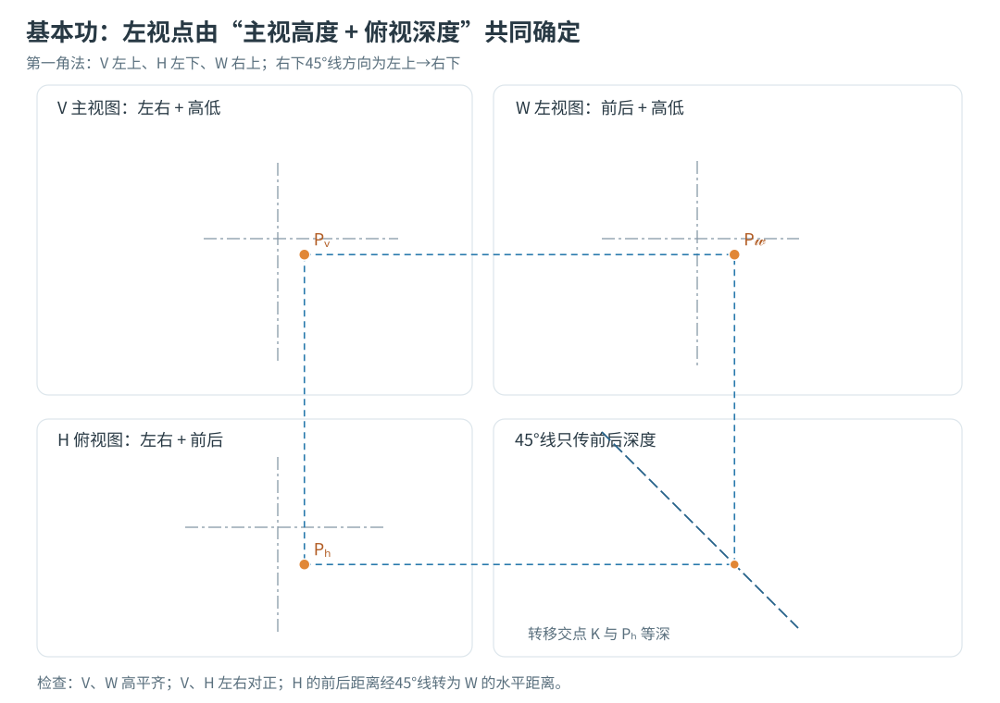

*标准三视图：同一个点从主、俯投影确定左视投影，45°线位于右下角。黑色为物体轮廓，蓝色细线为辅助线，青色为本步确定的线；正式图线仍须检查遮挡。*

### 2. 45°线到底在做什么？为什么不能乱换方向？

假设你已经找到一个点的主视影子和俯视影子，现在要找左视影子：

**第1笔：**从主视影子向右画一条细水平线。它告诉你：**新点只能落在这个高度**。

**第2笔：**从俯视影子向右引细线，接到右下角的45°转移线，再从转移位置向上引线。它告诉你：**新点只能落在这个前后位置**。

**第3笔：**两组条件相遇的地方，就是新点的位置。

为什么？因为它必须**同时**与主视同高、与俯视同深。满足其中一个条件还不够。

**本习题册常用的45°转移线在右下角，纸面上由左上斜向右下。** 如果改画成另一斜向，却不改变转移步骤，就会把前后位置翻转。遇到不同视图布置，先看展开关系，不要硬背一个方向。

### 3. 俯视图上方、下方，到了左视图会变成哪边？

在本文使用的第一角法布置及这套习题的转移约定里：

- 俯视图中**中心线下方**的点，转到左视图通常位于**中心线右侧**。
- 俯视图中**中心线上方**的点，转到左视图通常位于**中心线左侧**。
- 原本在俯视水平中心线上的点，转到左视图也在相应的中心位置。

这不是“左右随便选一个”。它来自空间的前后关系和投影面的展开。换了右视图或不同布局，要重新核对。

特别容易混：**俯视图的上、下表示前后；主视图的上、下表示高低；左视图的左、右表示前后。** 所以同一张纸的“上”并不总代表空间的“上”。

### 4. 为什么圆锥有的母线在俯视中心线上？

圆锥可以想成许多条直母线从尖顶连到底圆边。**主视图最左、最右的两条轮廓母线**，位于穿过圆锥轴线、沿左右方向展开的那个平面中；它们的点在前后方向上恰好与轴线对齐。因此俯视投影落在圆的**水平中心线**上。

可是换一条绕到圆锥前面或后面的普通母线，它在俯视图就偏离这条中心线。

**正确说法不是“圆锥母线都投在中心线”，而是“特定方向上的轮廓母线，才有这个投影性质”。**

## 第二课：复杂补第三视图，不要从“画大框”开始

教材里组合体的难题，经常出现台阶、凹槽、穿孔、前后错开的凸块。你看着主、俯视图知道大概像个零件，但一补左视图，就不知道哪条线该延长、在哪里转折、哪些该虚。

真正的问题是：**新观察方向上，到底有哪些真实的面和棱？哪些叠在一起？**

### 方法一：先分“层”，再看每一层有什么

拿到主视图和俯视图，不急着描第三视图。先在旁边用铅笔写出或标记：

- 哪些是**顶面**，说明某一部分有多高；
- 哪些是**立面**，说明某个台阶在这里突然升高或降低；
- 哪些是**侧面**，说明凸块或凹槽在前后方向延伸了多少；
- 哪些是**孔壁或槽壁**，说明看起来封闭的外框内部其实还有结构；
- 哪些只是**中心线、尺寸线、对称线**，不是零件表面。

在俯视图里，凡是结构**从这里开始、从这里结束、深度关系从这里变化**，先作一个很细的分界记号。

**为什么这一步有用？**左视图沿前后方向展开。如果一块台阶只占前半段，你不能把它的高度线画满整个左视图；如果一条沟槽只在后半段，你也不能在前半段凭空画出槽壁。

### 方法二：每段先问“从左侧看，最高、最低能看到什么？”

举一个**教学拆解案例**：一个组合体有完整底座；前半段有一块较低凸台；后半段有另一块更高凸台；另一侧还伸出一块高于底座的侧台阶。

你不需要记下每个尺寸，先做三个观察：

1. **前半段有哪些实体？**从左边看，最外层能形成多高的轮廓？
2. **后半段有哪些实体？**有没有比前半段更高的台阶？如果有，轮廓在哪条深度分界线上突然变高？
3. **更靠远处的低凸台**是否被近处的高实体挡住？它是不是只能作为隐藏棱出现？

本文后面附有一套来自同一空间结构的规范三视图作图图例：先读主俯条件，再逐段求左视外轮廓。示例不冒充教材特定题号或尺寸。

### 方法三：内轮廓必须证明“这条棱真的存在”

外边界画出来后，再回到题目检查内部。

想象一个台阶面和一个竖直面相交，它们交出的那条线是真实棱线，应继续判断投影和可见性。反过来，如果只是在俯视图中有两条投影线交叉，**不能因此判定零件上有一个交点或一条棱**。

看到内部线段，问：

- 这条线是**两片真实表面的交界**吗？
- 如果属于孔口，它是圆柱孔的**前边界**还是**后边界**？
- 如果属于凹槽，它的两个端点是否落在槽壁与其他面的真实交界处？
- 这个位置是否已经有另一条更靠近观察者的棱或轮廓投影重合？

**结论：纸上的交叉，是投影关系；实体里的相交，才是空间关系。二者不能划等号。**

### 方法四：用“端点追问”拦住最常见的错线

假设一段凸块只延伸到俯视图某条横线为止，那么新视图对应的轮廓线，**也必须在相应深度处停止或转折**。

不管是横线、竖线还是曲线，都做这四次检查：

**从哪里开始？**——原题哪个实体边界要求它从这里开始？

**为什么这样走？**——它在一个平面上、属于一条棱，还是某个曲面的轮廓？

**在哪里停止？**——它遇到另一片面、孔口、台阶终点，还是被遮挡？

**要画成什么线型？**——近处有没有实体挡住它？

**没找到结束原因，就不要凭感觉延长。**

### 方法五：遇到孔和槽，不要把“一个圆”当作“一个面”

俯视图看到一个圆，可能对应凸出的圆柱台，也可能对应向下挖的圆孔；主视图中因此出现的实线、虚线会不同。要结合另一个视图和题目条件判断是加料还是去料。

再如一个 U 形槽，从某一方向看像凹口；换个方向可能只看到两条槽壁棱，甚至完全被外表面挡住。**先确认结构是实体还是空缺，再推导投影。**

### 复杂补第三视图的完整下笔顺序

- **第一轮，框架：**中心线、基准、外轮廓最高最低与前后分界，全部轻画。
- **第二轮，结构：**逐个寻找凸台、凹槽、孔壁的真实边，标注每条线从哪个表面来。
- **第三轮，遮挡：**从侧面向里看，哪块实体在前，哪条边在后？每段分开判断。
- **第四轮，反查：**把得到的第三视图反投回已知两视图，找出超出、缺失或对应不上的线。

**如果两个已知视图不足以确定唯一空间结构，怎么办？**明确写下哪两个结构都能满足题意，再寻找尺寸、对称、剖切、通孔等附加条件。没有附加条件就保留不确定，而不是为了交卷强行猜一个。

## 第三课：截交线——先不管是什么曲线，只找“都在上面”的点

**截交线是截切平面与原来物体表面的共同边界。**

一张纸板斜着切穿圆锥：交线上的任何一点，既要在圆锥侧面上，又要在纸板所在平面上。只满足一个条件，就不是交点。

这句话已经足够指导手工作图。

### 教材习题 3-6-3：不知道曲线名称，怎样画出截圆锥的两个未知视图？

这一题的训练重点是**主视图给出斜截位置，利用水平辅助圆向俯视、左视求点**。我们完全不需要先喊出“椭圆”。

#### 第1步：认清完整圆锥和截平面

在主视图找到圆锥的轴线、两侧轮廓母线，再找到题中那条斜截边界。

**为什么斜线不直接等于空间交线的真实形状？**因为从主视方向看，截平面在这个方向积聚或表现为一条斜线。空间中前侧、后侧许多不同的交点，可能压到同一条斜线上。

#### 第2步：先找截交线与轮廓相遇的位置

沿斜截线观察，它与圆锥主视轮廓母线、实体边界在哪里相遇？这些位置往往是最容易确定的**特殊点**，可以先标记。

为什么先找它们？它们帮助划定交线可能出现的范围；没有这个范围，后来即使找到一般点，也容易把曲线画出实体表面。

#### 第3步：在两端之间选一个普通高度

随便选一个便于作图、又不经过已有特殊点的高度，画一条**水平细辅助线**。

它在主视图与斜截线相交的位置，叫做这个高度上的**截平面候选点的主视影子**。

此时只知道它的高度和左右位置，**还不知道它在圆锥前面还是后面**，千万不要直接在俯视图点一个位置。

#### 第4步：同一高度把圆锥“水平切一刀”

这里是整题最重要的推理：

圆锥越往尖顶越细，越往底部越粗；在**同一高度**绕着圆锥一圈，截面边界是一个圆。

那么这个辅助圆的大小从哪里来？

沿刚才那条水平辅助线，看它与圆锥**轮廓母线**相交的位置。圆锥中心线到该交点的距离，就是这一高度的辅助圆半径。

**为什么要量到轮廓母线，而不是量到主视斜截点？**因为圆的大小由圆锥自身决定；斜截点只告诉你截平面在哪里，不能代表那一高度整个圆锥有多宽。

#### 第5步：去俯视图画辅助圆

以俯视图中圆锥轴线的投影点为圆心，用刚才取到的半径画一个细圆。

这个细圆的意义是：**同一高度上，所有可能位于圆锥侧面的点，都在它上面**。

再从第3步确定的主视斜截点，向俯视图作同名投射线。

这条投射线的意义是：**真正的截交点必须保留主视图已经给出的左右位置**。

#### 第6步：为什么一下得到两个点？

那条投射线和辅助圆一般会相交于**两个位置**：一个在圆锥前侧，一个在后侧。

这两个点都满足：

- **在辅助圆上**，所以属于该高度的圆锥表面；
- **与主视斜截点对正**，所以保留了截平面要求的左右位置和高度。

这两个条件同时成立，它们才是同一高度上真正要找的截交点。

**不是辅助圆上任何位置都可以取；也不是投射线上的任何位置都可以取。只能取两者真正相交的位置。**

特殊情况下会只交一个点（相切）或没有交点，这时要根据实际高度和实体范围判断，不能硬凑两个。

#### 第7步：换几个高度重复，点自然显示走势

往上一点取一组，往下一点取一组。你会看到：

- 由于不同高度的圆锥大小不同，辅助圆变大或变小；
- 由于主视斜截线倾斜，投射线的左右位置也在变；
- 每次真正合格的点，都必须同时满足这两个变化。

因此，**曲线向哪边偏、哪里宽、哪里窄，都是这些点推出来的**，不需要提前想象一个标准椭圆套进去。

#### 第8步：分清前侧、后侧，再连接

把每一组点按其所在的**空间前后分支**分开。沿圆锥表面顺序连接前侧点，再连接后侧点，最后检查它们在哪些特殊位置汇合。

**千万不要把同一高度的前后两个点直接当成相邻点用直线连起来。**它们可能隔着圆锥内部空间。

#### 第9步：再转移到左视图

每找到一个俯视点，就已经知道它的前后位置；主视中同名点则已给出高度。

用第一课的45°转移方法，把俯视点的前后位置转到左视图，再与主视传来的高度线相交。每一个左视点都必须有自己的**主视—俯视来源配对**。

#### 第10步：最后才给曲线命名和判线型

如果所有相邻点形成闭合、连续的投影轮廓，才进一步认识它的形状；若它被有限圆锥边界截断，就以真实端点为准。该题在既定几何条件下得到通常所说的**椭圆类截交线**，但这是**求点后的总结**，绝不是画图的前提。

是否画成实线，还要检查该观察方向下交线有没有被剩余圆锥表面挡住，不能因为已经找到点就全描成粗实线。

### 教材习题 3-6-7：不预先知道“抛物线”，能画出转折的交线吗？

和上一题一样，先找截平面与圆锥表面真正共同拥有的点。不同处在于：**这次截平面在题设中与圆锥一条母线方向平行**。这只是阅读题图时可以观察到的**几何条件**，还不是让你直接描曲线的答案。

**第1步：**找斜截边界与有限圆锥表面、底部边界相遇的真实端点，暂记为两端。它们决定最终交线画到哪里为止。

**第2步：**像3-6-3那样，取一个高度，过主视斜截点作投射线，在俯视的同高度辅助圆上找真正的公共点。

**第3步：**不断换高度，就会得到一组又一组前后位置。你会逐渐看出，两支点列朝同一侧靠近，然后在一个特殊位置折返到另一侧；这时才需要专门确定**最左或最右的转折点**。

**第4步：**转折点不能“随手画在右边”。先根据辅助圆、对应投射线和圆锥的对称中心面，寻找**前后两侧位置在俯视中汇合**的候选点；再返回主视验证它确实在截平面上、也在圆锥表面上。

**第5步：**连接时从一端沿同一空间分支走到转折点，再沿另一分支走向另一端。不要把它与圆锥的**尖顶**混为一谈：曲线的“转折点”是投影走势发生转向的位置；圆锥尖顶是原物体自身的顶点，它们通常不是同一个点。

**第6步：**最后看实际所得点的形态，并结合“截平面平行母线”的条件，才认识到课本所称的**抛物线截交**。

> 这一题的目标不是背“平行母线就画某个固定开口的图”，而是：**即使遮住曲线名称，也能从端点、辅助圆、对正投影、转折点逐点画出它。**

### 3-6-3 与 3-6-7 到底有什么共同点？

两道题完全可以使用同一套手法：**找同一高度 → 画圆锥水平辅助圆 → 与斜截点的投射线求真正交点 → 保持前后分支 → 转移视图 → 连接、裁剪、判可见性。**

两题结果不同，是因为**截平面位置不同，导致每个高度的公共点变化规律不同**。并不是因为画题前先选择了不同的曲线工具。

## 第四课：相贯线——两个曲面都经过，才算真正相交

截交线是**平面和曲面**的公共点；相贯线是**一个曲面和另一个曲面**的公共点。

比如一个竖圆柱与一个横圆柱相遇，从外观上会出现一条弯曲边界。很多同学会记住“两个圆柱相贯时图上有个弧”，却不知道弧上的点怎么来。

现在把口诀暂时全部放下。

### 先分清课本中的“简化画法”和“准确画法”

教材习题 **3-7-1、3-7-2、3-7-3、3-7-5** 主要训练规定的简化表达、已知圆弧条件和轮廓定位。它们可以按教材给出的简化方法处理，**但不能把画出的简化V形或圆弧，误当作真实空间交线本来就有尖角或恰好是一段任意圆**。

习题 **3-7-6、3-7-7** 更适合训练“不预先知道形状”的准确逐点方法：选辅助点，通过两个曲面和不同视图的共同条件把它求出来，再连接。

### 教材习题 3-7-6：主视图右凸的相贯曲线，为什么会落在那里？

先认清题目：**左视图中给出圆柱的圆形轮廓，俯视图可取得另一方向圆柱的半圆形轮廓，主视图要补出相贯曲线**。不要直接在主视图拿圆规作一段“差不多的右凸弧”。

#### 第1步：先找两个圆柱真实相遇的范围

分别指出“这是第一个圆柱的侧面”“这是第二个圆柱的侧面”。它们的公共边界才是目标。

主视图外面某个位置虽然也可以画出漂亮的弧，但它没有来源，就不能算相贯线。

#### 第2步：先找最容易证明的端点、极值点

从已知视图中寻找两曲面相交范围的上下端点，及最向右鼓出的候选位置。

**为什么极值点不能先随便放在中间？**因为相贯线最鼓的位置，是相交两曲面共同约束下的结果，不一定等于某个已知圆的普通圆周极值点。需要反查另一个视图。

#### 第3步：在左视圆周上先选一个辅助点

选圆周上一个既不是最上端、也不是最下端、便于作辅助线的位置。

它告诉你两件事：**这点处在一个特定的前后深度；它有一个明确的高度。**

但注意：**只在左视圆周上，不等于已确认它同时属于另一圆柱。**还要做下一步。

#### 第4步：把这个前后位置转到俯视图

沿习题使用的45°线，把左视圆周点的前后距离转回俯视图。再在俯视图中检查：在这条深度线上，另一个圆柱的轮廓或母线允许哪些位置属于它的表面？

这一步才给出相贯点可能的**左右位置**。如果出现不止一个候选位置，要根据空间前后分支继续区分，不能随机选。

#### 第5步：把“左右”和“高度”合到主视图

俯视图确定左右位置后，**从该俯视点向主视图引竖直辅助线**；左视图确定高度后，**从左视点向主视图引水平辅助线**。两个条件交汇的位置，就是要求的主视点。

为什么落在这里？因为同一个空间点：

- 在左视图符合第一个圆柱的轮廓条件；
- 在俯视图符合另一圆柱的轮廓条件；
- 在主视图保留了刚才得到的**左右位置和高度**。

这不是“凭感觉选的弧上点”，而是两组来源同时规定的位置。

#### 第6步：多取点，但不要把两个分支接反

沿已知圆周逐渐取更多辅助点。对每个点，重复同样的深度转移、俯视找位置、主视合点。

如果同一组条件产生前后两支空间候选点，**一支接一支**。不能简单按主视图纸面上的远近连线，否则会在空间中“跳到另一边”。

#### 第7步：先细连接，最后判断凸出、光滑与实虚

把端点、极值点、普通点按空间顺序细线连接。此时若呈现右凸形态，是**点列共同决定**的，而不是画之前猜的。

然后检查曲线是否在真正的两个实体表面上、有无超出实际圆柱端面、有没有被近处曲面遮挡。通过这些检查，再按规范整理线型。

### 教材习题 3-7-7：主视图中央下凹，最低点为什么在中心线上？

这题的训练路线可以换成**先从俯视图出发**。

**第1步：**主视图待补位置有一段下凹的边界。先从题目已知的左右边界确定两端点；**暂时不画圆弧**。

**第2步：**在俯视圆周选一个普通点。俯视图给了它的**左右位置**和**前后位置**，但没有高度。

**第3步：**用45°线将它的前后位置送到左视图；在左视半圆或相应曲面轮廓上找到满足这个深度的真实点，才能知道它的**高度**。

**第4步：**将俯视确定的左右位置向主视图引线，再将左视确定的高度向主视图引线。两线相遇，得到新的主视相贯点。

**第5步：**换不同俯视点重复。先在中心两侧成对取点，比较它们是否处于相同高度，检查题目给出的对称条件是否成立。

**第6步：**对于主视图中间最低的候选点，不能仅因图形对称就把一个点画在正中。必须回到俯、左视图检查：**哪个空间点真的在两片圆柱面上？它投回来是否处于主视中心线？它的高度是否确实最低？**

**第7步：**两侧点列按原来的空间顺序连接，形成中央下凹的连续边界。最后检查遮挡，决定何处粗实、何处细虚。

重要提醒：**主视“中间最低”不是一定等于圆柱实体本身最低的位置。**它取决于两个曲面在什么位置相交，必须回到共同点来证明。

### 教材 3-7-1、3-7-2、3-7-3、3-7-5：简化相贯时为什么不能乱画？

这些题可以用同一套语言逻辑检查：

| 习题 | 先看什么 | 最容易错在哪里 |
|---|---|---|
| **3-7-1** | 相贯处的两个端点、题目给定的圆弧条件 | 下凹弧的大小和位置凭感觉估计 |
| **3-7-2** | V形两端与中间的规定定位点 | 把简化V形误认成真实交线的尖角 |
| **3-7-3** | 上、下两段交线各自的端点和所属曲面 | 把上段和下段当成同一条线乱接 |
| **3-7-5** | 左视凹弧的端点、凹向和教材已知的半径或构造条件 | 把“弧的最凹点”直接当作“圆心” |

特别解释 **3-7-5 为什么弧的最凹点不是圆心**：

圆心是**用圆规画圆时针尖所在的位置**；弧最凹点只是圆弧上的**一个点**。它们不是同一种对象。

如果题目给定圆弧半径，应该先固定两端点，再按两端点到圆心等距的条件，结合弧段应朝哪边凹来选圆心。仅凭两端点通常还不够，还要给半径或其他构造条件；如果条件不足，就不能自创圆心。

**简化画法要服从教材规定；准确求解则要服从曲面共同点。不能把两套方法随便混用。**

## 教材逐题跟画｜把“为什么”落实到每一笔

前面已经讲过共同方法。下面拿出习题册，按题号真正练习。**不要先看习题讲义里的红色答案线**；用纸盖住它，只看题目给出的黑色轮廓、中心线、尺寸和视图位置。

每道题都按同一种格式检查：

- **看图时要认出什么？**明确原物体、缺失视图、真实边界。
- **第一笔为什么从这里开始？**寻找至少两条可复查的条件。
- **新点为什么恰好在那里？**追溯点属于哪片曲面、哪个截面和哪个投影。
- **线怎么连、连到哪里停？**保持空间分支，不能擅自延伸。
- **用什么方式排错？**反向投影、对称关系、可见性与端点验收。

以下题号对应之前的第三章习题整理，所有彩色图都是**方法示意，不是把教材原图重画成答案**。教材真实尺寸和缺失线的位置，必须在纸质原题上确定。

### 实战一｜习题 3-6-3：不预先画椭圆，把圆锥截交线逐点找出来

**这道题到底给了你什么？** 主视图中能认出圆锥两条外轮廓母线、中心线和一条斜截位置；俯视、左视需要完成截交曲线。主视的斜线只反映截平面在这个方向的投影，并不是空间曲线本来的弯曲样子。

**这道题到底要你求什么？** 不是求“某一张椭圆的长短轴”，而是找到同时位于**圆锥侧面和截平面**上的一串空间点，再把这些点放进俯视、左视图。

#### 请拿纸笔，按下面的顺序做

**第 1 笔：先轻画完整圆锥的中心线与必要辅助母线。**  
为什么：切掉一部分以后，原圆锥的尖顶可能已经不在实体上，但完整圆锥的母线仍可用来找同高度的截面大小。它是**求点的依据**，不意味着切掉的部分最终还要画成实线。

**第 2 笔：在主视图标出斜截线与左右轮廓母线相交的两个特殊位置，暂称 A、B。**  
为什么它们必须在这里：A、B 同时落在截平面投影位置和圆锥轮廓母线上，满足两种条件，不是你随手从斜线上挑的。要注意：在这个题型中，它们可以是**主视投影段的端点或轮廓极值点**，不能因此把整条空间截交线误认为从 A 起、到 B 止的一条开口线；圆锥斜截形成的闭合空间交线在其他视图里可能还会绕回去。

**第 3 笔：暂时不连 A、B，在斜截线的中间另选一点 P。**  
为什么要选普通点：只知道两处特殊位置，还不知道曲线在俯视图里有多宽，尤其不知道前侧、后侧分别在哪里。找一个一般点，就能检验后面的取点方法到底会不会用。

*3-6-3 步骤图①：主视找到截平面的位置、完整圆锥轮廓与特殊点。黑色为物体轮廓，蓝色细线为辅助线，青色为本步确定的线；正式图线仍须检查遮挡。*

**第 4 笔：过 P 画水平细线，一直画到完整圆锥的外轮廓母线。**  
这条线相当于在 P 所在高度，把圆锥水平切开。圆锥在固定高度的圆周大小，由**这一高度的轮廓母线距离中心线多远**决定。

这里最常犯的错误是：把**主视 P 到中心线的距离**当成水平辅助圆的半径。P 只是截平面要求的位置；辅助圆要由**完整圆锥**的同高度截面来确定。

**第 5 笔：到俯视图，以圆锥轴线的俯视投影为圆心，画同高度的细辅助圆。**  
为什么圆心一定在这里：水平切正圆锥形成的圆与圆锥共轴，所以它的中心落在原圆锥轴线上。它不是“画得像”就可以挪动的一个圆心。

为什么不是画原来底圆那么大：P 的高度往往高于底部，圆锥越往上越细，同高度的辅助圆一般比底圆小。

**第 6 笔：从主视 P 向俯视图引投射线，找到它与辅助圆的交点。**  
这就是整道题的关键。辅助圆说“必须属于这层圆锥侧面”；主视 P 的投射线说“必须保持截平面已经给定的左右位置”。只有两者真正相遇的地方才合格。

一般会找到前后**两个不同的俯视点**。为什么不是随便挑一个？它们虽然主视重合、处于相同高度，但在空间中一个靠前，一个靠后。把其中一个丢掉，曲线就少了一半信息。

*3-6-3 步骤图②：同一高度的水平辅助圆与主视投射线相交，得到两个前后点。黑色为物体轮廓，蓝色细线为辅助线，青色为本步确定的线；正式图线仍须检查遮挡。*

**第 7 笔：在斜截线上再挑两到四个不同高度，重复第 4～6 笔。**  
顺序是：先选主视 P，再找母线确定辅助圆的大小，最后用投射线求真正交点。不要倒过来先画一个“差不多的椭圆”，再把辅助点拼进去。

**第 8 笔：按“前侧一串、后侧一串”整理点序。**  
同一高度得到的前、后两点，不是让你拿尺子横着一笔连过去。正确做法是沿圆锥表面的一支，依次连接相邻高度的对应点；另一支也按自己的空间邻接顺序连接。在确实汇合的轮廓位置再接通，必要时增加点把曲线走向画顺。

**第 9 笔：把已经证明的俯视点逐一转到左视图。**  
每个点都找齐两项：主视 P 给**高度**，俯视相应点给**前后位置**。用本习题册第一角法布局的45°转移线传递前后距离，和主视水平传来的高度线相交，左视点才确定。前侧点要一直作为前侧点跟踪，不要和后侧点调换。

**第 10 笔：最后整理完整交线、真实边界和线型。**  
细线连接、反查点的位置、检查有无越出实体；然后沿观察方向逐段判断可见性。圆锥本身的切后轮廓要保留，辅助圆和投影线只保留为轻细构造线或擦去。**到这里再去认识这条线的曲线名称，名称并未参与求点。**

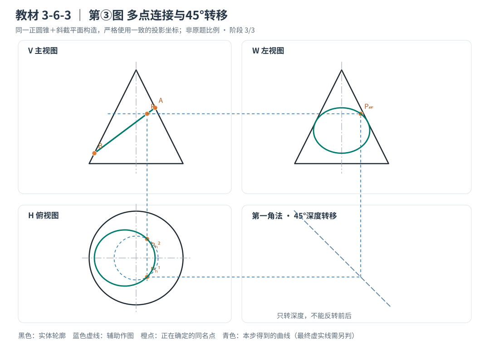

*3-6-3 步骤图③：多次取点以后连接俯视曲线，并通过45°线转移到左视。黑色为物体轮廓，蓝色细线为辅助线，青色为本步确定的线；正式图线仍须检查遮挡。*

#### 学会以后应能独立解释

- **问：俯视点为什么落在这个小圆上？** 答：它处于这个高度，圆锥这一层的表面恰好是一圈小圆。
- **问：为什么又必须落在这条直投射线上？** 答：它还要与主视斜截位置保持左右对应。
- **问：为什么出现前后两个点？** 答：相同的左右位置可能经过圆锥前后两侧。
- **问：主视轮廓上的 A、B 是不是整条空间交线的两个“断头”？** 答：不一定；必须检查空间交线是否连续绕回。
- **问：左视图某点为何向右而不是向左？** 答：来自俯视的前后位置和统一的第一角法转移方向，而不是眼睛猜的。

> **这道题的验收不是“画得像椭圆”，而是每个点都能从辅助圆和投射线反查，两支点列正确汇合，视图对应无镜像错误。**

### 实战二｜习题 3-6-7：不知道是什么曲线，怎样找到真正的转折点？

这一题仍是圆锥受平面截切，却和 3-6-3 有一个重要区别：**观察题图中截平面方向，会发现它与完整圆锥的一条母线方向平行**。看到这个关系，先记下来；**不要立刻凭“平行母线”就描一条现成的抛物线。**

**第 1 笔：认出截平面方向。** 在主视图中找斜截线，再找与它方向平行的圆锥母线，轻画延长辅助线加以比较。为什么要先做这个：后面求出的点列能否形成闭合走势，与截平面如何穿过圆锥有关。

**第 2 笔：确认两个实际边界位置。** 主视斜截线可能分别遇到底部实体边界和另一侧外轮廓。把这两个题设给出的边界点标出来，不要把已经切去的完整圆锥尖顶当成实际交线端点。**空间物体被切掉后，构造顶点不再自动属于实际零件。**

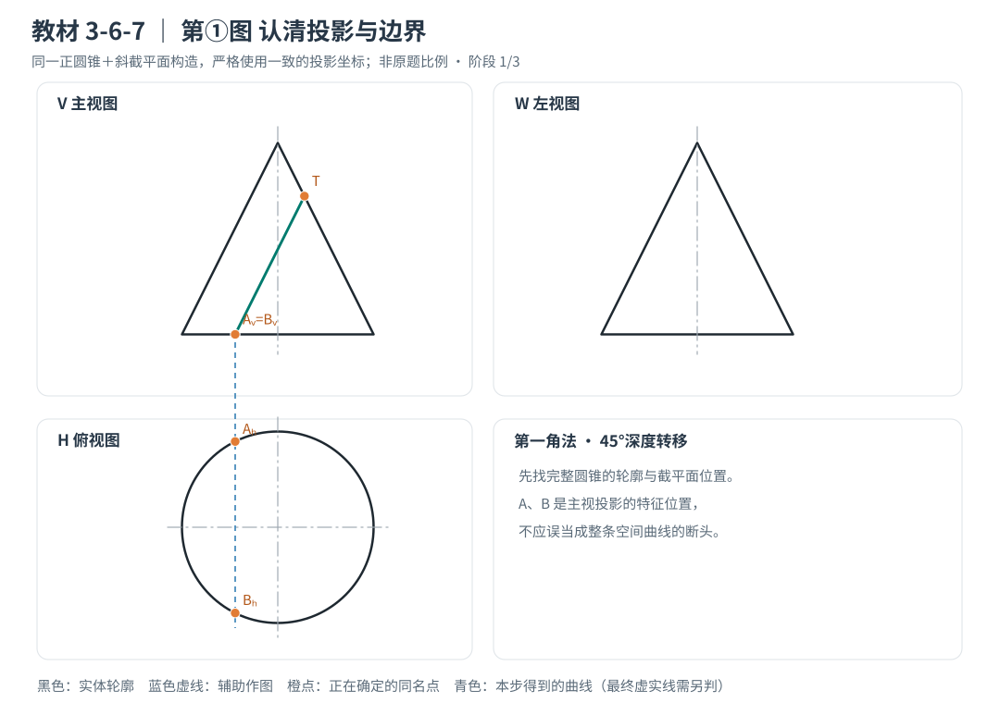

*3-6-7 步骤图①：截平面方向和完整圆锥外轮廓。黑色为物体轮廓，蓝色细线为辅助线，青色为本步确定的线；正式图线仍须检查遮挡。*

**第 3 笔：在斜截线中间选一个 P，作同高度的水平线。** 同 3-6-3 一样：这是找到一个真正位于截平面上的候选高度，不是为了事先选某个“曲线半径”。

**第 4 笔：用该高度圆锥母线确定辅助圆，再到俯视图画圆。** 为什么还可以画圆：平面怎么斜切，原圆锥在同一高度的**水平截面仍然是圆**。改变的是截平面挑中了这圈圆上的哪些位置，不是圆锥本身忽然变成别的表面。

**第 5 笔：由 P 向俯视图作投射线，与辅助圆取交点。** 注意同样可能出现前后两个点。给它们分开标记，别让一个主视点的两个空间位置混成一个。

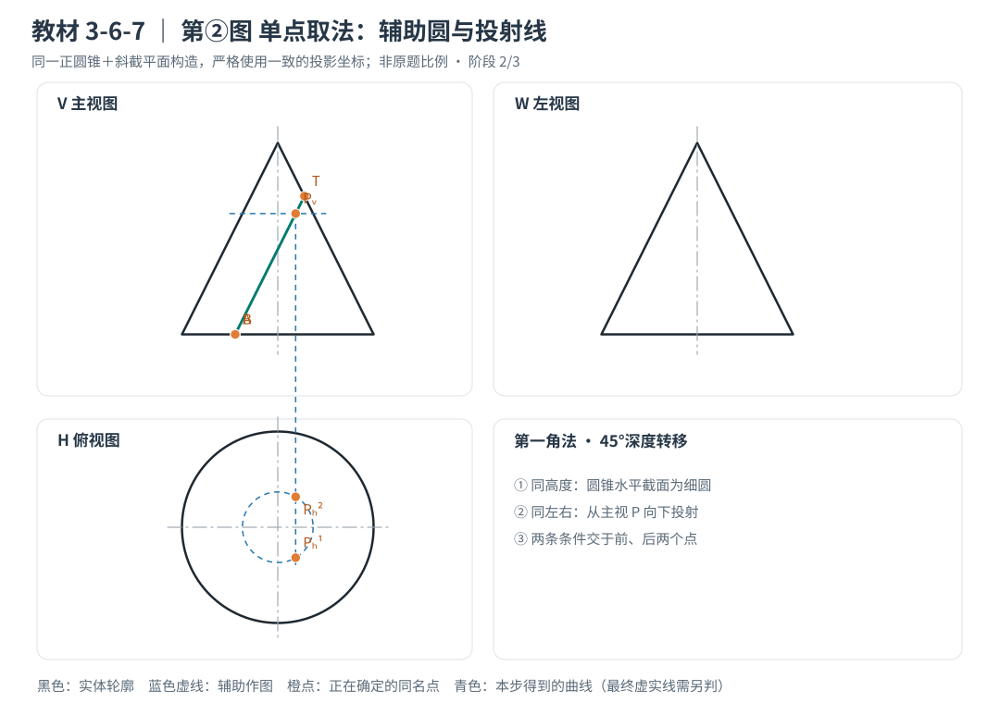

*3-6-7 步骤图②：由截平面和同高度辅助圆取到前后对应点。黑色为物体轮廓，蓝色细线为辅助线，青色为本步确定的线；正式图线仍须检查遮挡。*

**第 6 笔：沿斜截线往两侧再取不同高度，重复求交。** 每一组点都遵循同样的“斜截点 + 同高度辅助圆”规则。如果某处取不到交点，要先检查所取高度是不是已经超出了该有限实体或截面实际范围，不能硬造一个点。

**第 7 笔：顺着前、后两组点分别画细曲线，寻找真正转折处。** 有时你会发现两组点逐渐接近，在某个地方合到一起，形成纸面上最靠左或最靠右的平顺转向位置。**这个转折位置才是投影曲线的极值点**。它应由两个几何条件共同确认，不能因为“图大概应该向右鼓”就把它画在最右边。

**第 8 笔：不要把三种“顶点”混起来。** 圆锥顶点是完整圆锥自身的尖顶；交线与实体的相交边界点是曲线的实际端部；俯视图最靠右的点只是该**投影曲线的转折点**。三者大多数情况下并非同一位置。

**第 9 笔：依次转移到左视图。** 主视提供高度，俯视提供前后距离；使用和前一题一致的45°线转移。如果左视图上下位置与主视不平齐，或者两支前后颠倒，就不要继续描粗，先查投影关系。

**第 10 笔：在实体边界处停笔，最后才认识曲线类别。** 不要把两个实际端点在不应该连接的地方强行封成闭合线。由于截平面与母线的关系，这道教材例题最终可归为抛物线截交，但**整个作图过程只依赖找点，并没有用这个名称算出任何点**。

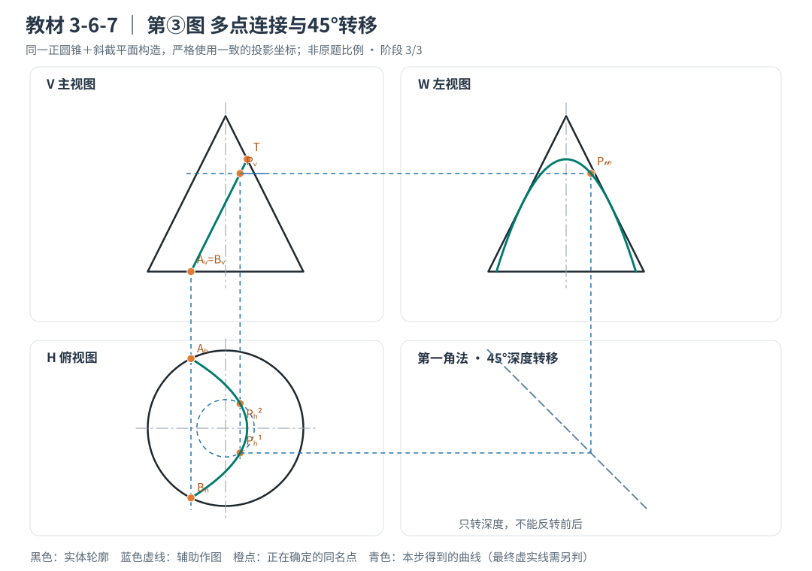

*3-6-7 步骤图③：把各高度公共点连接，得到投影转折，再向左视转移。黑色为物体轮廓，蓝色细线为辅助线，青色为本步确定的线；正式图线仍须检查遮挡。*

**和 3-6-3 的最大区别：**两题的*求点步骤基本相同*；因为截平面位置不同，合格点形成的空间走势、最终在图纸上是否有闭合边界和极值位置不同。**不要两道题分别死背两套画法。**

### 实战三｜习题 3-7-6：相贯曲线向右鼓，最右点 M 为什么不能随手画？

这道题转向圆柱与圆柱的交线。先不看右凸的参考曲线，认清三个视图：

- **左视图：**能看到其中一个圆柱的圆形投影，帮助确定前后位置与高度。
- **俯视图：**有另一个圆柱的相关半圆形边界，帮助确定前后位置与左右位置。
- **主视图：**等待你把“左右位置”和“高度”合到同一个点上。

**核心问题：一个相贯点必须同时在两个圆柱面上。** 左视图圆周上的点还只是一个候选；没有经过俯视图的另一圆柱面检查，不能直接把它放到主视曲线上。

#### 先找到三个特殊位置

**第 1 笔：找上边界 A。** 在题图中寻找真实相贯范围和原有圆柱轮廓相接的上方位置。为什么是它：再往外已经不同时属于两个实际表面，交线不应该穿出边界。

**第 2 笔：找下边界 B。** 同理，必须从实际相交轮廓与其他视图对应关系确定，不能以 A 为起点随手按对称距离点一个 B；如果题目结构确实关于水平中心面对称，才可用对称作为核查。

**第 3 笔：确定最右点 M 的求法，而不是直接画 M。** 在这个习题讲义所用的对称模型中，曲线最右位置与某个特殊前后深度位置对应。先从左视圆的相应特殊点出发，传到俯视另一曲面，取真正的交点，再返回主视。**M 是两个曲面共同点的投影极值，不是 A、B 的中点，也不是想象中一段圆弧的圆心。**

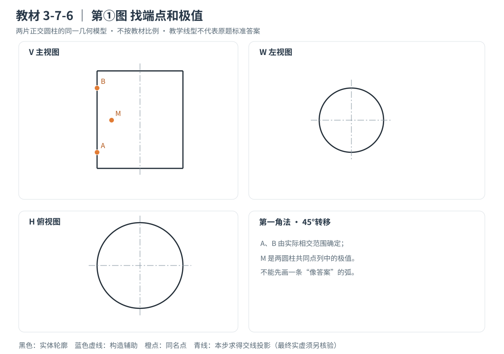

*3-7-6 步骤图①：两圆柱的完整投影轮廓，以及交线端点、极值点。黑色为物体轮廓，蓝色细线为辅助线，青色为本步确定的线；正式图线仍须检查遮挡。*

#### 再求一个普通点 P，保证自己不是“照答案”作图

**第 4 笔：在左视图圆周上选一个普通点 P 的左视投影。** 为了便于检查，先选圆周上偏上、又不在最高点的地方。它给出一个明确的**高度**和**前后位置**。

**第 5 笔：把这个前后位置通过45°线转到俯视图。** 在俯视图画出对应深度的细辅助线。这一步**只转移深度**，并没有自动确定相贯点的左右位置。

**第 6 笔：用这条深度线与俯视图中另一个圆柱的相应半圆轮廓求交。** 为什么取这个交点：它既与左视所选点同深，又落在另一个圆柱表面的投影边界上。若出现两个候选点，要判断属于题图的哪一侧真实表面，不能随意挑取镜像位置。

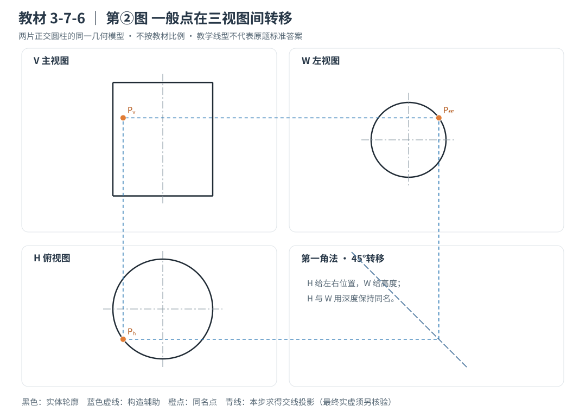

*3-7-6 步骤图②：同名点从左视、俯视对应到主视，位置不是凭曲线形状猜出。黑色为物体轮廓，蓝色细线为辅助线，青色为本步确定的线；正式图线仍须检查遮挡。*

**第 7 笔：向主视图作两条细线。** 从刚才的俯视点向主视图竖直引线，固定**左右位置**；从左视点向主视图水平引线，固定**高度**。两者交点才是主视相贯点 P。

**第 8 笔：检查它确实是同一个空间点。** 反向看：主视 P 往下应回到刚才俯视那个点；主视 P 往右应回到左视所选高度；两张图中前后位置通过转移线对应得上。如果有任何一个对应不上，你得到的是两条辅助线的误交，而不是两个圆柱的公共点。

**第 9 笔：多选几组左视圆周点，重复左视 → 俯视 → 主视。** 尤其在主视曲线弯得最明显处多取点。如果题设对称，上下两侧应有对应点，左右位置相同而高度对称；一旦不对称，优先排查前后转移方向，而非把点硬拉成对称。

**第 10 笔：按空间分支顺序细线连接 A、一般点、M、一般点、B。** 这时自然可以看出主视图某一段向右鼓。**绝对不要因为它向右鼓，就找一个圆心随意画圆弧**：准确相贯线通常不是一段你可以任意选半径的圆。

**第 11 笔：对真正的有限实体检查遮挡。** 哪一段属于外侧可见边界，哪一段被另一圆柱挡住，要结合两个圆柱实际相交方式与观察方向判断。之前的讲义使用过自洽教学模型，并不等于原题每段线型都经过独立 CAD 验收，因此这里不臆定原题所有部分必画实线。

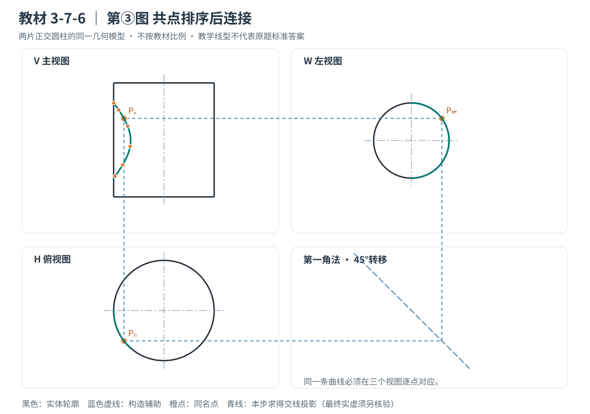

*3-7-6 步骤图③：同一组空间公共点在三视图中分别形成什么线。黑色为物体轮廓，蓝色细线为辅助线，青色为本步确定的线；正式图线仍须检查遮挡。*

#### 最容易出错的追问

**“左视圆周点已经在曲面上了，为什么还不能算相贯点？”** 因为它只证明属于**一个**圆柱，另一个圆柱是否经过它尚未确定。

**“为什么 P 不是主视图两条已知边界的随意交点？”** 因为只有从俯视、左视合回来的**同名空间点**，才满足第二个曲面的约束。

**“为什么 M 在右边？”** 不是因为曲线美观，而是从某个特殊前后位置求回主视以后，它在这条连续点列的左右位置中最突出。具体位置要由原题几何决定。

### 实战四｜习题 3-7-7：主视图中央下凹，最低点为什么在中心线？

这题特别适合与上一题对照：**3-7-6 从左视圆周开始选点；3-7-7 可以从俯视圆周开始选点。** 最后都要把另外一张视图补给的信息合回主视。

**题目观察：**主视待补交线，俯视有圆形轮廓，左视有半圆形轮廓。目标是在主视图画出连续的下凹边界。注意：这里说“下凹”只是帮助你核对题图任务，**不是要求你先画一段下凹圆弧**。

#### 一次完整的求点循环

**第 1 笔：标出俯视圆心和水平、竖直中心线。** 这一步先固定“左右对称”和“前后深度”的基准，不是让你从圆心直接取相贯点——圆心在圆内，未必属于圆柱的侧表面。

**第 2 笔：在俯视圆周的最左、最右位置分别选两点。** 在这个题设的对应圆柱关系下，它们位于圆周的左右极限位置；前后距离处于中心位置，容易在左视上找相应高度，再回到主视确定两侧端点 A、B。**不要只因为主视看起来两边一样高，就跳过对应检查。**

**第 3 笔：先检查中间最低点 M 的来源。** 俯视圆周上前后最远的点，与左右中心线对齐。把这个前后深度传到左视半圆，在该半圆**真正相交的位置**读取高度，再返回主视的中心线求点。对本题的几何布局而言，得到的主视点低于两侧端点，成为最低点 M。

**为什么 M 在中心线上？** 因为选定的俯视圆周前后极限点的**左右位置就是中心位置**，回到主视也必须落在中心线；不是因为“所有下凹曲线最低点都应该在中间”。

**为什么不能把俯视圆心直接投上来？** 因为俯视圆心不是圆柱侧面上的任意可取交线点；真正要找的是**圆周上的前后极限位置**，它们在投影中和中心线的关系与圆心不同。

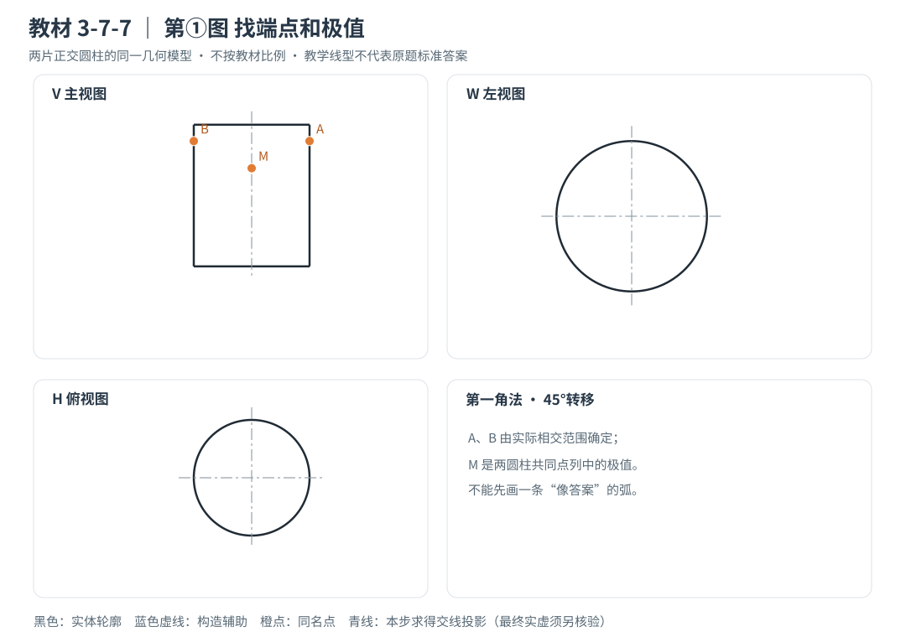

*3-7-7 步骤图①：上下对称结构中的左右端点和中心投影极值。黑色为物体轮廓，蓝色细线为辅助线，青色为本步确定的线；正式图线仍须检查遮挡。*

**第 4 笔：在俯视圆周偏左、偏前（或题设给出的对应分支）的位置取一个普通点 P。** 从 P 向主视图竖直引细线，它固定的是**左右位置**，暂时不知道高度，所以还不能落笔描 P 的主视点。

**第 5 笔：再从俯视 P 向右作水平细线，交本题右下角45°转移线。** 从交点向上引线，进入左视图区。请记住：此时到左视只传了“前后距离”，尚未确定高度。

**第 6 笔：用这个位置与左视半圆求交，找到同一个空间点的左视影子。** 这一步终于补齐高度。若延长后根本碰不到有效半圆边界，先查深度传递或空间分支，**不能凭已有曲线样子硬凑一个高度**。

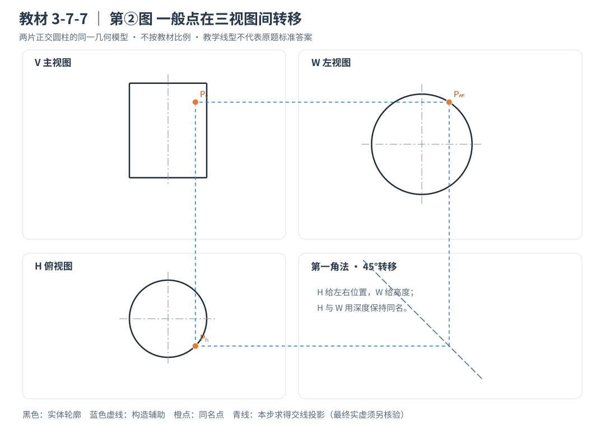

*3-7-7 步骤图②：俯视点提供左右位置，左视圆周提供高度，同名点回到主视。黑色为物体轮廓，蓝色细线为辅助线，青色为本步确定的线；正式图线仍须检查遮挡。*

**第 7 笔：把左视取得的高度水平传向主视。** 它和第 4 笔从俯视 P 向上引的左右定位线相交。交点就是 P 的主视位置。

**第 8 笔：在俯视圆周另一侧找对应点，做同样一套转移。** 比较主视两点是否关于中心线对称且等高。此题具备相应对称结构时应成立；若不成立，常见原因是把俯视前后方向在45°线处翻反了，或把半圆另一个分支取错了。

**第 9 笔：再补几对点。** 不要只靠 A、M、B 三点画任意圆弧。点够多后，从 A 沿一侧的点序经过 M，再沿另一侧走向 B，曲线自然平顺地向下凹。

**第 10 笔：检查端点与原主视轮廓的交接以及实虚线。** 不能越过左右肩部，也不能把最凹点当成空间里的实体尖顶。需要结合真实遮挡情况处理线型，而非仅因为图示向下凹就默认全为粗实线。

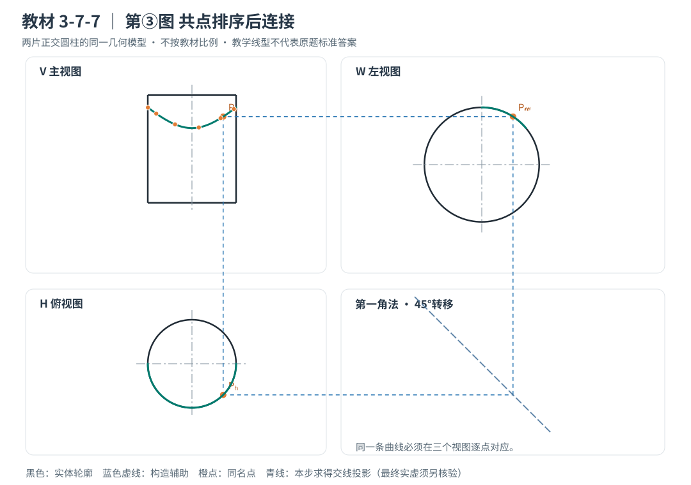

*3-7-7 步骤图③：连续取点以后，主视中央的下凹趋势才被确定。黑色为物体轮廓，蓝色细线为辅助线，青色为本步确定的线；正式图线仍须检查遮挡。*

#### 把两题放在一起比较

| 你现在知道什么 | 3-7-6 | 3-7-7 |
|---|---|---|
| 先在哪里选点 | 左视图的圆周 | 俯视图的圆周 |
| 一开始已经知道 | 深度与高度 | 左右与深度 |
| 必须从另一视图补什么 | 左右位置 | 高度 |
| 主视最终由什么定 | “左右位置线”与“高度线”相交 | 同样两条线相交 |
| 能否先用圆规画目标弧 | 不能 | 不能 |

两题一旦真正掌握，你遇到**不知道空间相贯线叫什么、也不知道最终像什么曲线**的新题，就有第一步可做：在某个已知圆周上取一个合理的点，去另一张视图找**第二个曲面是否允许它存在**。

### 实战五｜习题 3-7-1：教材允许简化圆弧，为什么还得先找圆心？

接下来四道属于教材讲解过的**相贯线简化表示**，不能把它们和前两道精确逐点求解混成同一套标准。

**第 1 笔：**观察俯视图的同心圆和左视半圆，识别**相交的两片圆柱曲面**，不要把上方看似矩形的轮廓直接误认为普通棱柱。

**第 2 笔：**到主视图找上方窄体与下方宽体相接的左右两肩，标 A、B。为什么端点在那里：两肩才是交界的投影位置，不是“差不多靠近相贯处”的任意位置。

**第 3 笔：**确认本题**要求简化圆弧**以及教材给出的半径或作弧构造条件。圆弧的圆心不是“连 A、B 后随便在中间找一个点”；圆心必须使到 A、B 的半径一致，并满足教材对圆弧凹向和大小的要求。

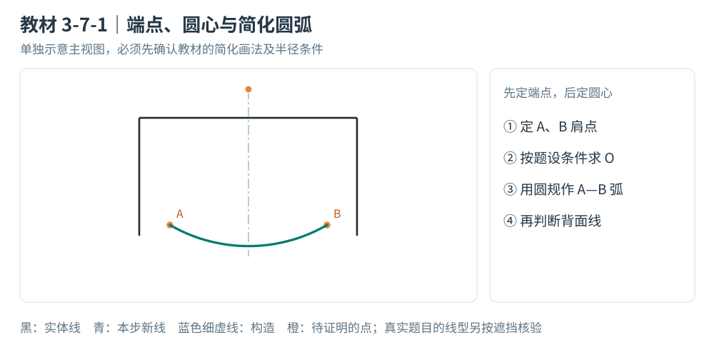

*3-7-1 对照图：两个端点已确定后，按教材给出的作弧条件确定圆心与下凹圆弧。黑色为物体轮廓，蓝色细线为辅助线，青色为本步确定的线；正式图线仍须检查遮挡。*

**第 4 笔：**确定圆心之后先用细线画一段由 A 到 B 的下凹弧，只保留真实交界范围。这里的最凹点是**圆弧上的点**，和圆心不是一回事。

**第 5 笔：**背面有需要表达的不可见相贯支线时，对照视向和另一视图检查后用虚线；不要把原辅助半径线当成空间棱线。

**第 6 笔：**擦淡圆心辅助线、半径线，仅保留应有的工程图线。能否解释 A、B、圆心、最凹点分别属于什么对象，才算完成。

**如果原题没有给可独立确定圆心的尺寸或简化构造条件：**不能把“我从参考答案量出圆心”包装成“独立推导”。要明确是按教材简化规则完成，还是只能进一步精确求交。

### 实战六｜习题 3-7-2：为什么可以画 V 形，却不能说空间里有尖角？

**第 1 笔：**先认清窄、宽圆柱的相交位置，主视左右肩 A、B 分别是简化线段的两端。

**第 2 笔：**找到主、俯视图一致的对称中心线。**对称只告诉你 V 字底点 C 的左右位置在中心线上**，还没告诉你它有多低。

**第 3 笔：**依据题图使用的简化作图关系或已知辅助圆弧，找出 C 的高度。C 既不能取 A、B 连线的中点，也不能看图凭感觉选一个“V 看起来合适”的深度。

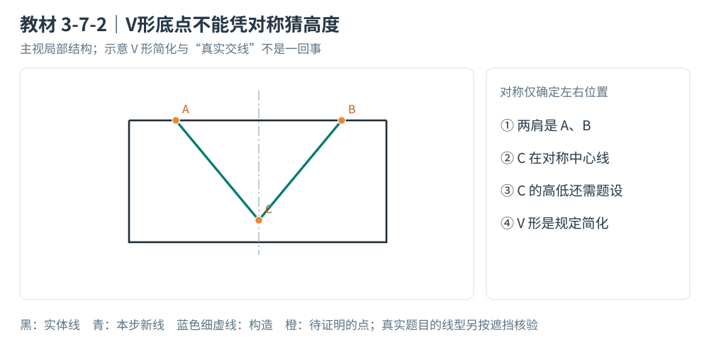

*3-7-2 对照图：对称仅确定V底点的左右位置，底点的高度仍需要题设条件。黑色为物体轮廓，蓝色细线为辅助线，青色为本步确定的线；正式图线仍须检查遮挡。*

**第 4 笔：**用细直线连接 A 到 C，再连接 C 到 B，检查两段是否按题设对称。这里的两条斜直线属于**教材指定的简化表达**。

**第 5 笔：**确认哪些是辅助线、哪些是最终图线；按教材要求保留正确的 V 形。**V 形折点是二维简化结果，不证明空间中的真实相贯曲线有尖锐折角。**

**第 6 笔：**如果将来题目改成“准确求相贯线”，就不能把这个 V 形直接照搬，而要回到 3-7-6/3-7-7 的两曲面共同点法。

### 实战七｜习题 3-7-3：同一图中上下两条弧，为什么不能当成一条画？

**第 1 笔：**先分别标出上部交线的两端 A、B，以及下部交线的两端 C、D。你要补的是**两段不同空间边界**，不是把某条弧复制两遍。

**第 2 笔：**按题目给出的简化位置关系，先处理上部。上弧中间位置 E 在中心线附近，比 A、B 更低；但这只描述**主视投影里的凹向**，不应直接把 E 叫作空间最低点。

**第 3 笔：**检查教材对简化半径、圆心或辅助圆弧的要求，先以细线画 A—E—B。不能因为已经知道了三个点，就说可以任意选半径。

**第 4 笔：**下部另起一段，按已知边界确定 C、D 和中央稍向上凸的 F。它与上弧来自不同的空间边界，圆心与圆弧范围要重新核对，不能直接把上弧平移过来。

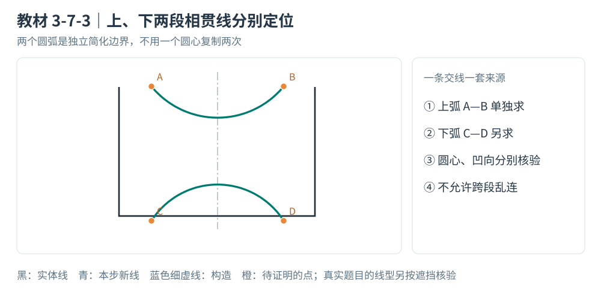

*3-7-3 对照图：上段与下段属于不同边界，端点及圆心必须分开核对。黑色为物体轮廓，蓝色细线为辅助线，青色为本步确定的线；正式图线仍须检查遮挡。*

**第 5 笔：**注意题图中可能还有相交的虚线。两条二维虚线交叉，**不证明空间里这两条线真的碰到一起**；主、俯、侧视图还要核对深度关系。

**第 6 笔：**分别整理上部可见弧、下部可见弧和背面的隐藏线，逐条检查端点。上弧不能错误接到下部的 C、D；下弧也不能越过实际接触范围。

**为什么是“一上一下”两种凹凸？**因为它们对应相交实体上不同的边界位置，投影到同一主视图以后，曲线相对于各自端点所处的位置不同，而不是为了画得对称好看。

### 实战八｜习题 3-7-5：左视凹弧到底往哪边凹？圆心为什么不在最凹处？

这题很适合练你之前问过的“**到底画在左边还是右边**”。

**第 1 笔：**确认要补的是**右上方的左视图**，而不是主视图。主视对应**左右+高低**，左视对应**前后+高低**，因此不要把主视左右直接抄成左视左右。

**第 2 笔：**在左视右侧的竖向边界上，先固定交线上端 A 和下端 B。为什么两点就在这条边上：题图中的交界与这个已知投影边界相接。各自高度从已有轮廓或主视对应位置取得。

**第 3 笔：**结合已知侧视结构判断交线朝**形体内部、纸面左侧**凹，先用很浅的细线确定大概的内部区域，**此时不要把它当成准确圆弧**。

**第 4 笔：**认清最凹点 M 的身份：它属于最后那段圆弧的**最左投影位置**。它不是圆心；拿 M 当圆心画弧，往往会把弧画成朝外鼓或无法通过 A、B。

**第 5 笔：**根据教材给定的半径、对称位置或可验证的简化构造关系求圆心 O。如果已知 A、B 和指定半径，可通过两点到圆心等距的条件寻找候选圆心，并根据凹向选择正确的一侧。**不能从原讲义参考答案里量到的 M 反推出圆心，再声称原题不看答案也能确定它。**

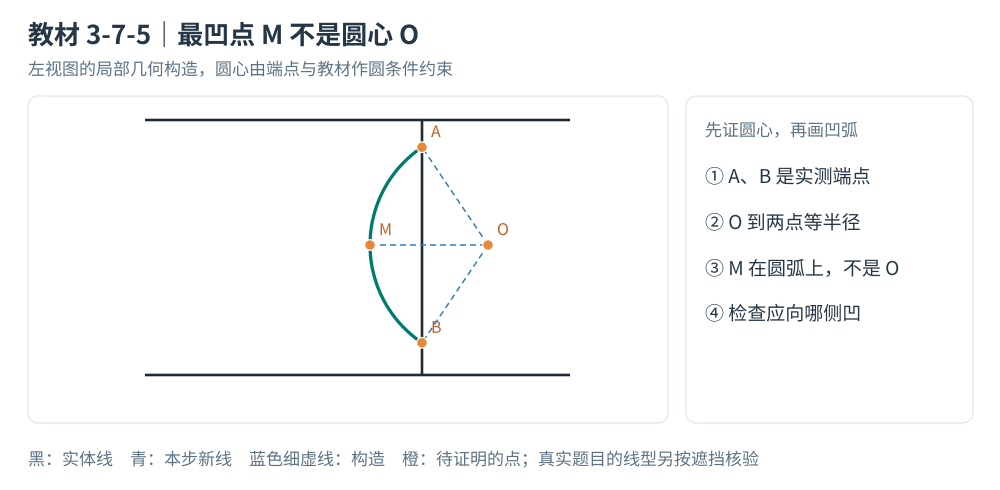

*3-7-5 对照图：圆心O和最凹点M是两个不同的点。黑色为物体轮廓，蓝色细线为辅助线，青色为本步确定的线；正式图线仍须检查遮挡。*

**第 6 笔：**圆心确定后，统一使用同一半径画完整的 A—M—B 弧段，检查是否从 A 无缝进入、从 B 无缝退出。端点与竖直轮廓是否相切不能仅凭“弧线好看”决定，须按实际交线与教材简化规则处理。

**第 7 笔：**保留该题要求的正确可见弧和其余已知线型，擦淡半径辅助线与圆心定位线。

**这题的关键收获：**“点画在左边”由左视的前后方位和实体相贯凹向决定；“它是不是圆心”由作圆的等距条件决定。**两个问题不是一回事。**

### 再补一个复杂第三视图的完整推理样例：前后错开的凸台与凹槽

这一节用**教材组合体章节常见的结构特征**训练，不指定未经核实的教材题号。它不是某一道教材原题的复刻；要得到真实习题的标准第三视图，仍需逐条核对那道题的主、俯视图。

**题型：**给主视图、俯视图；零件上存在前后错开的两段凸台和一个局部凹槽；补左视图。

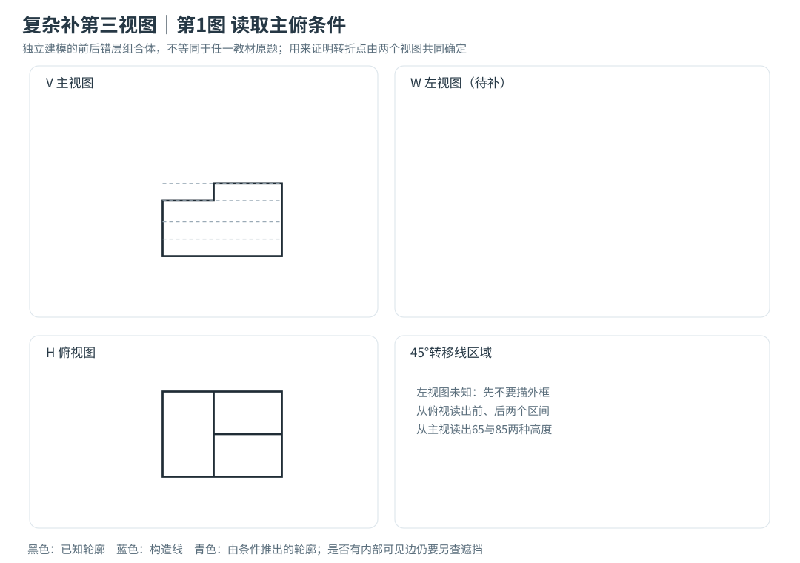

*组合体步骤图①：在主视、俯视读取高度和前后结构范围，左视暂不动笔。黑色为物体轮廓，蓝色细线为辅助线，青色为本步确定的线；正式图线仍须检查遮挡。*

**第 1 步：**只看俯视图，找出所有“从这个前后位置开始、到那个前后位置结束”的结构。用细线把前段、后段、凹槽段的分界标出来。为什么要分：这些深度范围不同，侧视图的形状就可能在分界处改变。

**第 2 步：**回到主视图，给每段结构找对应的高低。你在主视图看到一条水平台阶线，却不能立刻认为它横贯全部深度；必须再问俯视图告诉你这段台阶从前到后究竟延伸多远。

**第 3 步：**在左视区先轻画从上到下的高度辅助线，再把俯视中的前后分界通过45°线转移。**只有高低与深度的两条条件相交，才能放一个左视转折点。**

**第 4 步：**沿每个深度区间逐段检查：从左侧看，哪块实体形成外边界？在哪个深度处分界会让外轮廓突然抬高或降低？在这两个转折点之间如果确实是平直表面，才用直线连接。

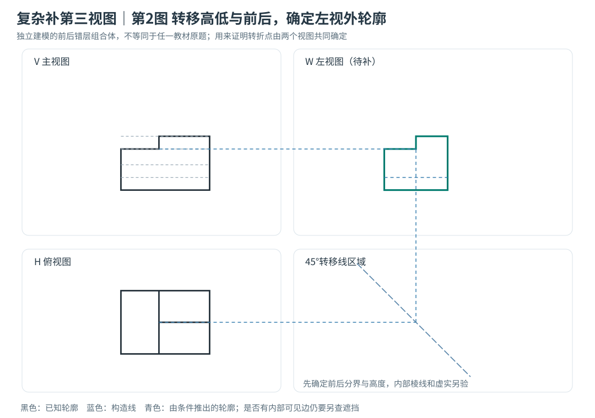

*组合体步骤图②：把高度和前后分界转到左视，先求证外轮廓，再研究孔槽与遮挡。黑色为物体轮廓，蓝色细线为辅助线，青色为本步确定的线；正式图线仍须检查遮挡。*

**第 5 步：**再检查凹槽。凹槽缺掉的是实体材料，不要把槽的空白误填成凸台。槽的左右侧壁、槽底和槽口在侧视里可能变成可见实线，也可能被近处表面挡住；应先找实体结构后判线型。

**第 6 步：**沿一条空间棱追踪到真正终点。比如某凸台只延伸到后段开头，那么它的侧视棱线必须在那里停止或转折，不能一直画到零件另一端。

**第 7 步：**检查投影重合的两条棱是不是空间同一条。如果一条靠左、一条靠右，虽然侧视投影位置一样，仍可能因为遮挡而只能显示近处一条。不能看到投影交叉就强行接线。

**第 8 步：**把做出的左视再反查主、俯视：每个凸起都有对应高度，每个凹槽都有对应深度，每个转折都有实体来源。如果两视图仍允许多个空间结构，应明确保留歧义而不是擅自选择一个。

**这段练习不要求你预先知道零件三维长什么样，而是训练逐段建立三维关系。** 当原题包含圆柱孔、圆锥面或相贯边界时，以上步骤与前面“辅助圆/两个曲面共同点”取点法结合使用。

### 八道题学完之后，再做一轮“闭眼不看答案”的反向检验

| 学习任务 | 你必须能解释的“为什么” | 不能靠什么 |
|---|---|---|
| 3-6-3 | 主视点为什么能产生两个俯视点；怎样按前后分支连接 | “答案就是椭圆” |
| 3-6-7 | 转折点从哪一组共同点中出现；为什么不是圆锥尖顶 | 先画现成抛物线 |
| 3-7-6 | 为什么先在左视圆周选点，再由俯视补左右位置 | 凭感觉画右凸弧 |
| 3-7-7 | 为什么中间最低点由俯、左两个视图共同确定 | 看着对称就画中点 |
| 3-7-1 | 为什么下凹弧的端点、圆心与半径必须被约束 | 任意选圆规半径 |
| 3-7-2 | 为什么 V 底点高度不能由“对称”一个条件决定 | 直接把两肩连成V |
| 3-7-3 | 为什么上下两条弧不可跨段相接 | 复制同一条弧 |
| 3-7-5 | 为什么最凹点不是圆心、为什么凹向图纸左侧 | 从参考答案反推圆心 |

如果某一点依旧解释不出来，退回**它所在的投影、它属于哪两个几何对象、空间连接是否成立**这三个问题，通常就能发现自己缺的是哪个条件。

---

## 第五课：画实线、虚线之前，先想象观察者站在哪里

同样一条空间线，换个方向看，可能全能看见、全被挡住，或者只看见其中一段。

所以不要背“中间就是虚线”“外边界就是实线”。正确的判断只有一句：**沿着观察方向看过去，先遇到的是这条线，还是另一片不透明的实体表面？**

### 先区别三种容易混淆的线

- **真实棱线：**两片实体表面交成的一条边，比如台阶转折。
- **真实交线：**截平面与曲面、两曲面之间真正相交的轨迹。
- **视向轮廓线：**圆柱或圆锥从某方向看形成的外边缘，不一定是实体本身的一道棱。

它们都可能成为图纸中的实线，但产生原因不同；中心线、投影辅助线又是另外的绘图约定。

### 遮挡判断的实际操作

**看主视图：**想象自己站在零件正前方，沿视线往后看。前面挡住后面的表面。俯视图常用来帮助你区分前后位置。

**看俯视图：**想象从正上方向下看。高处的实体可能遮住低处的边；主视图帮助你判断谁高谁低。

**看左视图：**想象从零件左侧往右看。靠左侧的实体可能挡住更靠右的边；主视图帮助你确认左右位置的前后层次。

关键是**“更近”还不够**：两个对象还必须落在**同一条观察视线上**，前方的不透明表面才会实际挡住后面的线。如果根本没有重合遮挡，就不能随意画虚线。

线的一半被挡，另一半露出时，要在遮挡情况发生变化的地方分段。即使有两个实体边投影重合，也要遵守工程图线的优先关系，不能简单画成实虚两种线叠在一起。

## 第六课：遇到陌生题，照着这套“无公式作图口令”做

下面这套口令建议放在习题册旁边，做完一笔就检查一次：

**第一句：先找对象。**这道题缺的是实体棱、截交线还是相贯线？

**第二句：先找最确定的点。**与已知轮廓相交的位置、端点、极值点、对称轴上的特征点从哪里来？

**第三句：一个条件不够就找第二个。**截圆锥常用辅助圆加投射线；相贯线常用一个视图给位置、另一个视图给剩余位置。

**第四句：按同名点对齐。**主俯长对正、主左高平齐、俯左宽相等；45°线只传递深度。

**第五句：先分支，后连接。**前后两支不能接错；相近的二维点未必在同一空间曲线上。

**第六句：先细线，后定型。**点列没求够，不猜它一定是圆弧、椭圆或其他曲线。

**第七句：真实边界决定停止位置。**不延长到不该去的地方。

**第八句：站到观察者的位置判断可见。**同一条线上逐段比较遮挡，最后描粗。

## 第七课：用四道练习检查自己是否真正掌握

**练习一｜为什么会有两个点？**

主视截圆锥的一个斜截点位置已定，画出同高度辅助圆，再从主视向俯视引投射线。如果投射线穿过辅助圆得到两个交点：你能不用“因为答案是椭圆”这句话，说明它们为什么都可能成立吗？

**答题要点：**它们都属于同高度圆锥表面，且左右位置符合截平面在主视给出的限制；前后不同，所以暂时是两个不同的空间交点，不能只留一个。

**练习二｜为什么母线投在中心线上？**

主视圆锥最左轮廓母线上的一个点，俯视投影为什么落在圆的水平中心线上？换一条绕到圆锥前侧的普通母线还会这样吗？

**答题要点：**主视左右轮廓母线处于前后与轴线对齐的位置；普通母线不一定具备这个条件。

**练习三｜为什么曲线最低点不是随便画在中间？**

教材 3-7-7 中，如果把主视图中间最低点随手画在中心线上，画法缺少了什么证明？

**答题要点：**需要从另两个视图找到同一个空间点，并证明它同时属于两个圆柱面；中心线位置与最低高度都不能单靠画面“看起来对称”推断。

**练习四｜为什么同一条线会变虚线？**

某真实棱线从主视图看一部分露出、另一部分被凸台挡住，你会不会把整条棱一笔画成虚线？应该在哪里断开？

**答题要点：**不会。先求真实棱线的完整范围，再找观察视线上遮挡关系改变的位置；露出段和被挡住的段分别处理。

### 自测标准

如果你只能说“教材答案就是这样画”，说明还停留在模仿阶段。如果你能够在**不看答案**时说出：

- 这个点由哪两个条件共同确定；
- 这个点为什么偏左、偏右、偏前、偏后；
- 这段曲线与前后哪一支相连，为什么；
- 线段在哪里停止，为什么；
- 最后哪一段可见、哪一段不可见；

就开始真正具备了**几何逻辑驱动的独立解题能力**。

## 这与 DraftAI 自动解题有什么关系？

对于 DraftAI，“自动解题”不能仅等于“看图后输出一个像标准答案的图”。上面手工作图里的每一步，都应该在系统中保存可以检查的理由：

- **找点证据：**对应哪条原题线、哪个辅助圆、哪两个曲面的交点？
- **连接证据：**为什么属于同一条实体棱或同一条曲线分支？
- **投影证据：**三个视图中是否一直对应同一个空间点？
- **可见性证据：**哪片实体表面挡住这段线？在哪个位置开始和停止？
- **完整性证据：**是否存在漏点、漏段、错误端点或尚未解决的空间歧义？

**系统还不知道的线，不能假装已经知道。**空间结构不唯一、遮挡缺证据、曲线分支未确定时，就应保留“待判断”，而不是直接生成确定答案。

最终的作图动画，也要展示“为什么要取这个点、为什么下一笔要转移到这里”，而不只是把整张正确图纸逐条显现。

## 最后的理解

复杂补第三视图，是从已知轮廓找出**真实空间结构**；截交线，是从平面和曲面找到**共同点**；相贯线，是从两个曲面找到**共同点**。

看起来是三章不同内容，其实都可以用同一个流程：

> **先知道点属于哪里 → 再知道点在哪里 → 再知道哪些点能接起来 → 最后判断从观察方向能看到哪一段。**

从这一刻开始，遇到不知道名字的曲线，也不必停在“我不知道应该画椭圆还是抛物线”这一步。**你不需要先知道它叫什么，才能知道下一个点应该在哪里。**

---

**学习提示：**建议把教材 3-6-3、3-6-7、3-7-6、3-7-7 依次摆在纸上，按照本文的每一笔找点、连线，完成后再与教材参考答案核对。本文的示意图是语言逻辑讲解用图；具体图上端点、比例、完整遮挡和标准线型仍以实际原题独立验证为准。
