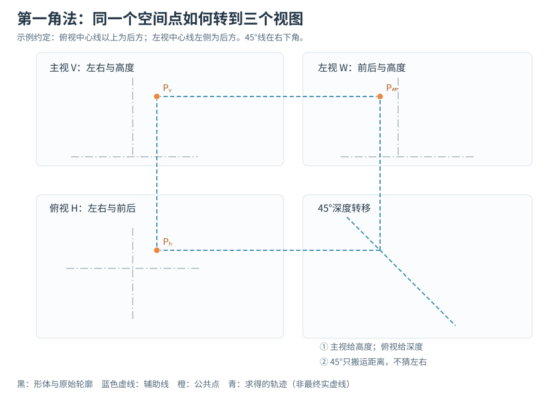
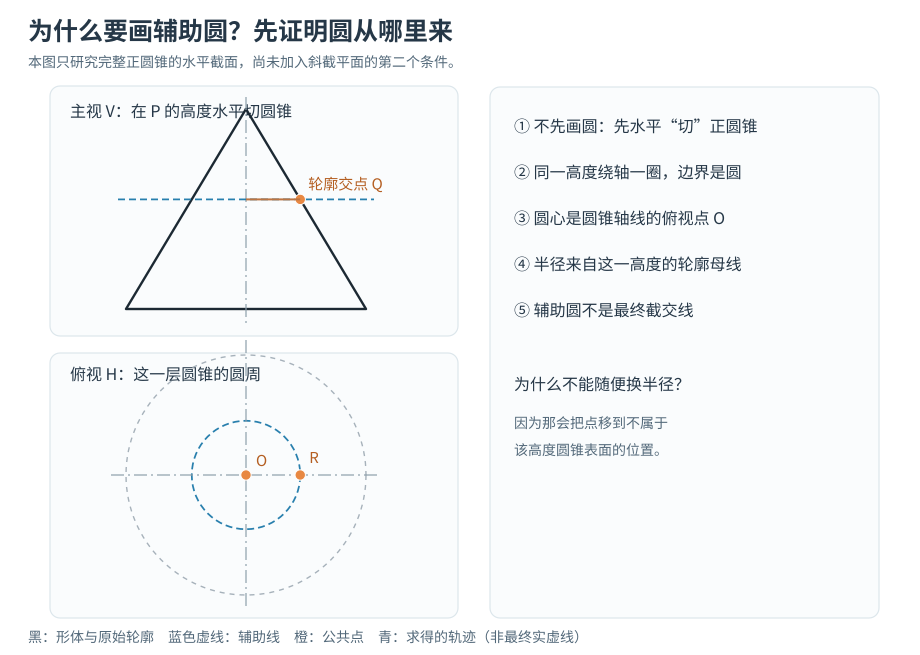
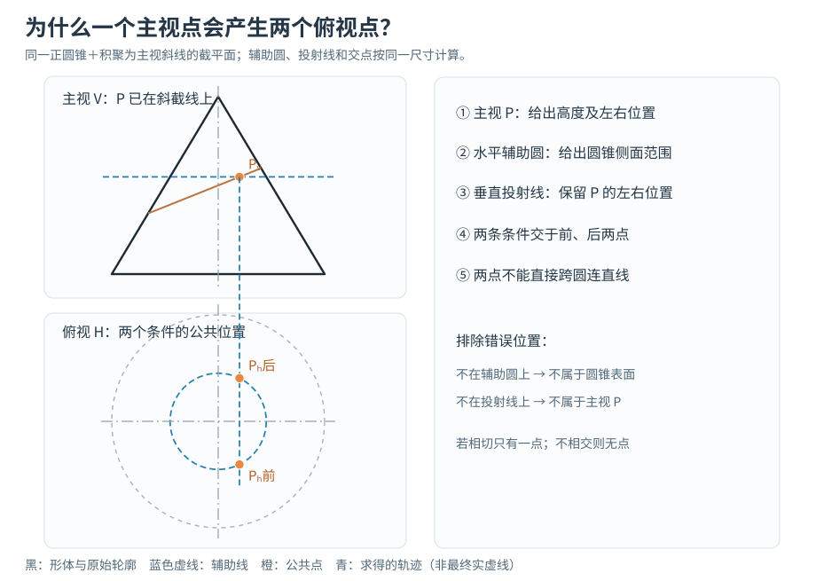
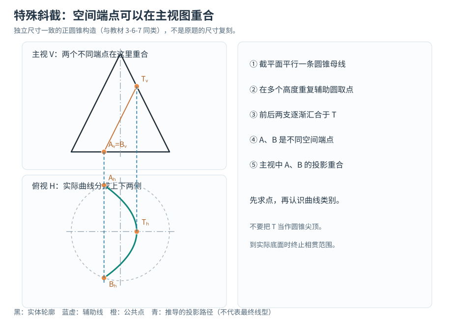
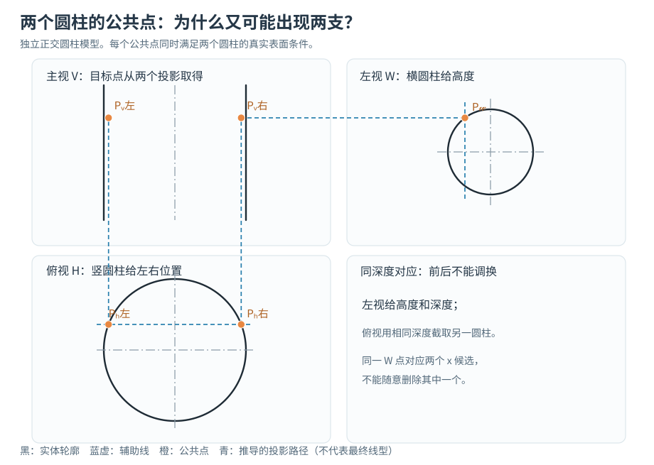
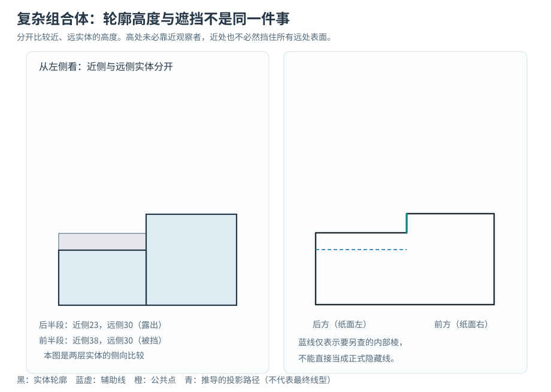
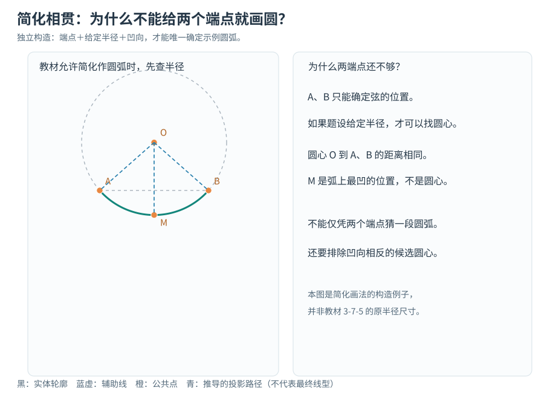

> **读完后要掌握的不是“哪种截法会出现椭圆”，而是：即使不知道曲线叫什么，也能从已知条件画出第一个点、第二个点，再找到正确的连接和线型。**
>
> 本文只用语言和作图关系，不用曲线方程。所有辅助线、辅助圆、连接线都要说明“为什么需要它”。

### 这篇文章怎样读

请准备纸、铅笔、尺、圆规，最好把第三章习题册放在旁边。读到一幅图时，先遮住青色结果，自己画蓝色辅助线；之后再看结果是否与求出的交点一致。

本文借用之前习题资料中的 **3-6-3、3-6-7、3-7-7、3-7-5** 等题型作教学对照。**配图是从同一套确定的几何条件独立推导的原理算例，不是教材原图或原题尺寸答案。** 其中 3-6-6 的原题尚未取得可靠核对依据，因此不冒充对该题的完整逐笔复原。教材题中的具体端点、可见性还应回到纸质原题检查。

本文不再重复堆砌八道题的相似口诀。我们只学一条主线：

**先弄清物体 → 解释为什么需要辅助工具 → 找到真正的公共点 → 搞清前后与分支 → 连接空间里确实相邻的点 → 判断观察方向和遮挡。**

---

## 第一课｜点为什么在这里，而不是另一边？

### 先认三视图究竟保留了什么

想象桌面上放着一枚小珠子。

- **主视图**：告诉你珠子偏左还是偏右、处于多高，却不能单凭这一张图判断它靠前还是靠后。
- **俯视图**：告诉你偏左还是偏右、靠前还是靠后，却不直接告诉你高度。
- **左视图**：告诉你靠前还是靠后、处于多高，却不能直接告诉你它在零件左右方向的具体位置。

这是找同名投影点的根本原因：**每张图都丢掉了一个方向的信息，必须由其他视图补齐。**

在本文采用的**第一角法**中，主视图在左上、俯视图在左下、左视图在右上。主俯保持左右位置对应，主左保持高度对应，俯左保持前后距离对应。

**图中这个 P 为什么会落到左视图那个位置？**

1. 从主视 P 向右画细水平线：这只能确定**高度**。
2. 从俯视 P 向右画细线，到右下方的45°转移线，再向上引线：这只确定**前后距离**。
3. 两条条件线相交，才有左视 P。

为什么是图上的左侧，而不是右侧？因为本图约定俯视中心线**上方表示较后的位置**，并且采用规定的第一角法展开；较后的点在左视图中位于相应的左侧。如果改成右视图，或者变更投影布局，必须重新核对方位，不能死背“永远在左”。

**小检查：**一条水平线只告诉高度，一条竖向转移线只告诉深度；少了任何一个条件，都还不能确定左视点。

## 第二课｜为什么要画辅助圆？这个圆从哪里来？

这正是前面讲解遗漏的基础。

先不要想截交线，更不要想椭圆。**只研究一只直立的正圆锥**。

从它底面往尖顶看，底部较粗，上部逐渐变细。假设拿一块水平透明板，在圆锥的中间某个高度穿过去。透明板碰到圆锥侧面的那一圈，就是一个圆。

**为什么一定是圆？** 因为我们讨论的是正圆锥：在同一个高度，绕中心轴线一周，侧面各点距离轴线相等。这些点围成圆周。圆不属于我们凭空添加的形状，而是**水平辅助平面与正圆锥侧面的真实交线**。

接下来逐笔回答“圆心和大小从哪里来”。

**第1笔：在主视图选定一个高度，画水平细线。**

为什么要画这条线？因为我们现在只研究**这个高度**上的圆锥表面。选择高度把复杂的整个圆锥，缩小成一圈较容易理解的位置。

**第2笔：让水平细线与完整圆锥的两侧轮廓母线相交。**

为什么要交到母线？轮廓母线限定了这一高度的圆锥最外侧。中心轴线到轮廓交点的距离，就是该高度水平截圆的半径。

**第3笔：到俯视图，以圆锥轴线的俯视点为圆心，画刚才半径的细圆。**

为什么圆心不能移动？因为正圆锥各个水平截圆与圆锥同轴。为什么半径不能取底圆半径？因为中间高度的圆锥已经比底部细了。

注意这条界限：

**画出辅助圆，只说明“指定高度的圆锥侧面在这一圈”；还没有说明其中哪一个点属于斜截平面。**

这正是我们还要做下一步的原因。

## 第三课｜实战：3-6-3 类型——为什么得到两个点，又为什么不能直接连？

我们现在在正圆锥上加一块倾斜截平面。此处讨论的情形是：**截平面在主视方向积聚成一条斜直线**。这点很重要；若截平面不是这种投影位置，就不能不加检查地照搬下面“主视一个点直接对应整个平面”的取点方法。

### 先找什么关键点？

第一批先找斜截位置与圆锥主视轮廓相遇的特殊位置。它们帮助界定主视投影的范围。

但请注意：**主视斜线两端，不一定是空间曲线真正断开的两个端点。** 截交线在空间里可能连续绕到圆锥背面，只是在主视方向被压成同一条线。

第二批需要找普通点 P。为什么要找 P？因为只有两端还看不出俯视曲线在中间怎样变化。

### 用一个 P 完整走过所有作图动作

**动作一：在主视斜截线上选择一个中间位置 P。**  
为什么可以选？因为该斜线代表截平面在这个方向的位置。P 的主视投影已经带有一个**高度**和一个**左右位置**，只是前后深度尚不明确。

**动作二：过 P 作水平细线，交圆锥完整轮廓母线。**  
为什么？要知道 P 所在高度上的圆锥有多粗；只有这样才能知道空间点还可能在哪里。

**动作三：以圆锥轴线俯视点为圆心，作同高度辅助圆。**  
为什么？它给出所有属于该高度圆锥表面的候选位置。

**动作四：从主视 P 向俯视图引投射线。**  
为什么？待求点在俯视图还必须保留 P 已知的左右位置。

**动作五：保留投射线与辅助圆真正相交的位置。**

图中出现 P后 和 P前，是因为同一条投射线穿过辅助圆时，在圆周的前后两侧各交一次。它们虽然在主视中重合，却是前后深度不同的**两个空间点**。

为什么一个在俯视中心线上方、一个在下方？因为在这张图的方位约定下，辅助圆的上半圈对应后侧，下半圈对应前侧。位置是两条辅助几何的交点确定的，不是由曲线名称决定。

**反例检查：**

- 如果把点画在投射线旁边：它不再与主视 P 左右对应。
- 如果画在辅助圆外面：它不在指定高度的圆锥表面。
- 如果漏掉其中一个交点：就遗漏了另一侧可能的空间交线。
- 若投射线只与圆相切，就只剩一个位置；如果根本不相交，就不能硬造两个点。

### 现在为什么仍然不能直接连两个点？

因为 P前 与 P后之间的直线通常**穿过圆锥内部**。而截交线应该沿着圆锥表面与截平面相交的轨迹走。

我们应该在不同高度重复取点，得到前侧的一串、后侧的一串。沿同一条真实空间分支的前后相邻点连接，最后再检查这些分支是否在轮廓位置汇合、是否被实际底面或其他边界截断。

**不是“点够多就画得圆滑”——而是“有连续的空间来源，才可以按顺序连起来”。**

### 为什么有些段画实线，有些段画虚线？

先不要凭俯视图上半圈、下半圈直接猜线型。你需要明确**观察者从哪里看、圆锥切去的是哪一边、剩余实体有哪些表面挡住目标线**。在同一投影位置上，如果有更近的实体表面遮住这段交线，它才属于隐藏部分；没有遮挡的才可见。

所以：**求点和连接完成，不代表线型已经自动确定。**

## 第四课｜对照实验：3-6-7 类型——为什么会出现转折？

这道类型的截平面与圆锥一条母线的方向平行。先记录这个几何关系即可，**不要先命令自己画抛物线**。

取点的方法和上一课相同：选主视截平面上的位置 → 找同高度辅助圆 → 由主视投射线求真正交点 → 在不同高度重复。

请留意图中三种不同的点：

**A、B：实际边界端点。** 它们在这个独立模型里都落在底面圆周上，空间前后位置不同。但主视舍弃了前后深度，因此 A、B 在主视图里重合。

**T：俯视投影的转折位置。** 沿着公共点列移动时，左右位置逐渐达到极值，再返回另一侧；T 因此是投影走势的特殊点，并不是原圆锥的尖顶。

**中间点：证明 A—T—B 的实际路径。** 如果只知道 A、B，就不能直接用直线代替曲面交线。必须求足够多的中间点并检查它们属于同一空间分支。

为什么 T 在这幅图右边，而不是左边？是这个模型里截平面倾斜方向、圆锥表面位置共同决定的。若倾斜方向相反，曲线转折方向也可能镜像变化。

这道例子最终可以按曲线类别认识为抛物线截交，但**名称是最后认识结果，不是找点工具**。如果实际零件只保留其中一段，那么它在真实实体边界处结束，不能为了符合某种曲线名称继续延长。

## 第五课｜两圆柱相贯：3-7-7 类型怎样迁移这套方法？

截交线中，我们要求某个点同时属于“一个平面”和“一个曲面”。

相贯线中，只需要把其中的平面换成**第二个曲面**，思路仍然一样：待求点必须满足两片真实表面的共同条件。

为避免对教材原图的错误猜测，下面采用**一根竖直正圆柱与一根水平正圆柱正交**的独立模型，验证和 3-7-7 相近的“两个视图共同定位”的逻辑。

### 为什么先到左视圆周上取点？

因为沿水平圆柱的轴线看过去，它的侧面截面表现为圆。左视这个圆周上的点，可以提供**高度和前后深度**。

但是这只证明点在水平圆柱的侧面上。**它未必同时位于竖直圆柱表面**。

### 为什么还要去俯视图找点？

俯视图里，竖直圆柱的侧面投影为圆周。把刚才左视点的前后深度转到俯视图，再与该圆周相交，就获得满足**第二片曲面**的位置。

这里可能得到左右两个位置。为什么不随便留一个？因为它们具有相同的前后深度和高度，却位于竖直圆柱的左右两侧，可能分别属于不同的相贯分支。

### 怎样回到主视图？

从俯视的候选点向上引对应线，固定其左右位置；从左视的同名点向主视水平引线，固定其高度。

两条辅助线的交点给出主视位置。每个候选点都要分别完成这一过程。

**为什么不能把主视中所有靠近的点一股脑连起来？**

因为一些点位于不同的空间分支，只是投影重合或接近。必须沿同一支交线的真实顺序跟踪，检查是否发生汇合、切触或实体边界裁剪。

本题说明：**辅助圆不是所有题的固定步骤。圆或辅助线的选择，取决于它怎样为待求点提供第二个可靠的几何条件。**

## 第六课｜复杂补第三视图：为什么一条线有时出现、有时消失？

补第三视图时，不能只盯某个点，还要把**面与实体所占的空间范围**找出来。

例如同一零件由近侧台阶与远侧台阶组合而成。从左侧看：

- 前半段的近侧台阶较高，挡住远处较低的台阶；
- 后半段的近侧台阶较低，远处较高的部分会露出来。

### 实际下笔顺序

**第一步：先从俯视图找前后分界。**  
为什么先找？因为新左视图把前后深度展开到纸面左右。某块台阶如果只占前半段，就不可能把它的棱线随意延伸到后半段。

**第二步：从主视图找各段高度。**  
为什么还需要主视？俯视只能说明结构在前后延伸多少，不能独立告诉我们它有多高。

**第三步：按深度区间分别决定外轮廓。**  
不是简单取“最近的实体”，也不是简单取“最大的高度”。应该判断在这个深度区间，从左侧是否能看到某个高度以上的表面。

**第四步：检查内部棱线。**  
有些真实棱线虽存在，但被近处实体遮挡；有些可能因为远处台阶高出近处实体而露出。先证明这条棱真实存在，再判断从左侧能不能看到它。

**第五步：到分界位置检查端点。**  
前半段的高台在中间结束，就必须检查外轮廓在那里转折；不能直接把它的最高水平线画到整个零件另一端。

这道题暴露出一个必须增加的规则：

**对于组合体和非凸实体，仅凭空间点的位置不够。还要知道各表面的前后顺序以及它们占据哪个深度区间。**

当两个已知视图容许多种不同三维结构时，必须寻找尺寸、对称、剖切或其他题设信息；如果仍不能区分，就不能声称已经唯一求出第三视图。

## 第七课｜为什么有些相贯题可以画圆弧、V形？

准确作图和教材允许的简化作图不能混为一谈。

例如某些题允许把相贯线简化成一段圆弧。即便如此，也不能只知道两个端点 A、B，就任意用圆规画一段弧。

**为什么要先找圆心？** 因为同一个圆弧上，所有点到圆心距离相同。教材若规定简化半径，我们可以根据端点和该半径找出候选圆心，再依题目给出的凹向选择正确的一侧。

**为什么最凹点不是圆心？** 因为最凹点 M 本身在弧上；圆心 O 是辅助构造位置。拿 M 当圆心，会生成另一条不满足原定半径条件的圆弧。

**为什么有些题最终画 V 形？** 如果题目要求的是规定的简化画法，V 形只是工程图中的简化表达，不能反推真实空间交线有一个尖锐折角。准确相贯时仍需回到公共点法。

所以碰到相贯题，应该先问：**要求准确求交，还是允许按教材规定简化？** 两者的验收标准不同。

## 第八课｜所有题型都适用的“每一笔六问”

以后遇到一条不知道为何出现的辅助线，不要先照画；先完成这六个问题。

| 必须回答 | 正圆锥辅助圆的示范回答 |
|---|---|
| **为什么需要它？** | 我还不知道指定高度上圆锥侧面的范围 |
| **它来自哪里？** | 正圆锥与水平辅助平面的交线 |
| **它怎样作出来？** | 同高度轮廓母线给半径，圆锥轴线给圆心 |
| **它能确定什么？** | 待求点必须落在这一圈圆周上 |
| **它还不能确定什么？** | 圆周上哪个位置属于真实斜截平面 |
| **画错了怎样发现？** | 点不在辅助圆或同名投射线上，便违反原来的几何条件 |

找到一个点以后，再问：

**它有几个候选位置？为什么在这一侧？**  
**它来自哪两个几何条件？**  
**它与下一个点是否真的在同一空间分支？**  
**这条线为什么在这里转折、停止或改成虚线？**

真正需要练习的不是背出所有步骤，而是能在陌生题中自己想出：**现在缺少什么条件，应该用哪一种辅助工具把它补上。**

## 第九课｜一张最后才用的解题检查单

做完整道题后，再逐项检查，不要把它当成开始作图前的机械口诀：

- **空间来源：**每个点、每条线能说明它属于哪片真实表面或哪个题设要求吗？
- **辅助工具：**每条辅助线、辅助圆的来源与大小有依据吗？
- **同名投影：**点的左右、高低、前后位置在三视图里互相一致吗？
- **候选点：**前后两个或左右两个候选位置是否被正确保留、裁剪或排除？
- **连接：**连续分支与真实端点是否正确？有没有把前后两个点跨实体直连？
- **可见性：**每段线是否检查具体遮挡实体？有没有把蓝色辅助线误描成正式虚线？
- **反向检验：**把求得的线重新投回已知视图，是否仍符合题图所有条件？

如果某一项还无法证明，不用猜一个看似正确的答案。先标记待核实，再回头检查缺的是哪一个几何条件。

## 练习：不看曲线名称，能不能自己选择辅助工具？

**练习一：**一只正圆锥被斜平面截切。你知道截线上某点的主视位置，却不知道俯视前后位置。为什么“同高度辅助圆 + 同名投射线”能够找点？为什么不直接用底圆？

**思考答案：**因为水平辅助圆给出该高度圆锥侧面的所有可能位置，同名投射线保留主视已经确定的左右位置；底圆代表的是另一个高度，不能代替本高度的圆锥表面。

**练习二：**两圆柱相贯，左视圆周某点已经找到了，为什么不能直接认定它就是相贯点？

**思考答案：**它还只属于其中一个圆柱，必须在另一个视图中确认第二个圆柱表面也经过同一空间位置。

**练习三：**你找到了两个端点，却还不知道要画直线、圆弧还是其他曲线。这时该做什么？

**思考答案：**先确定它属于真实棱线、准确交线还是规定的简化图线，再补足空间连续性、辅助点或半径等必要条件。两个端点本身通常不能确定曲线的全部形状。

---

### 结语

工程制图最有效的提问不是“我应该画什么曲线”，而是：

**“为什么这一笔必须存在？它依据什么画？如果把它移到另一边，会违反哪个已知条件？”**

能独立回答这些问题，就能在不知道曲线名称、不事先猜出全部三维形状的情况下，一点一点地把工程图推导出来。

*教学资料提示：本文基于第三章既有习题整理确定常见题型，图纸为独立建立的尺寸一致示范模型。未宣称代替教材原图、原尺寸或完整工程线型验收。*
